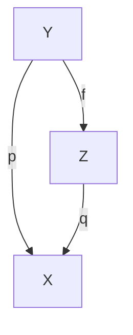
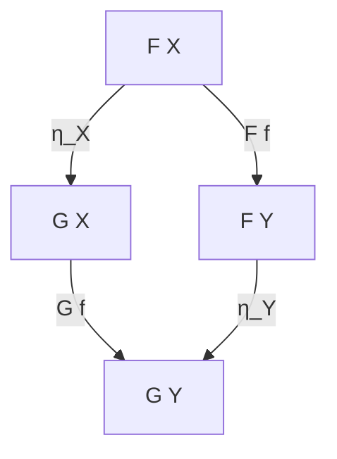
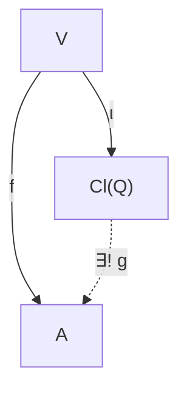
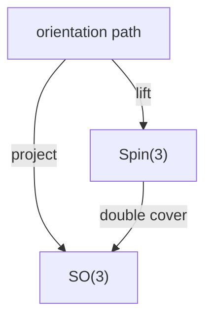
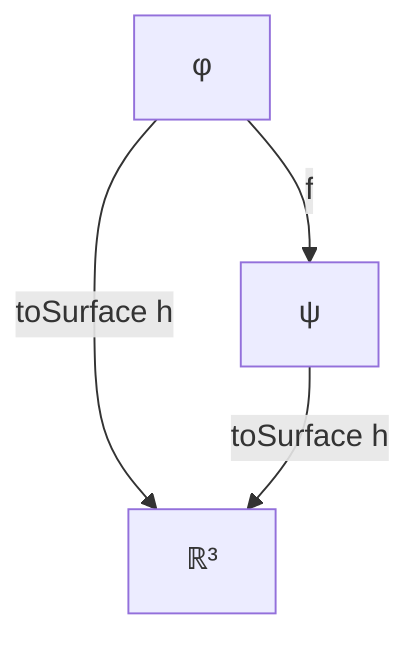

# Category Theory: A Working Dictionary

Category theory is a language for *structure-preserving maps*. It is useful
here not because the code needs another layer of abstraction, but because the
existing notes already contain the same patterns under different names: a
chart is a map, a reparameterization is a map between charts, a bundle is a
family of fibres, a section is a choice of point in each fibre, parallel
transport is a path-dependent linear map, and a numerical integrator is a
stateful step.

This note has two parts.

* **Part I** is the minimum vocabulary: category, functor, natural
  transformation, adjunction, limit and colimit, monad, groupoid, enrichment,
  Yoneda, and a case study in geometric algebra.
* **Part II** is the dictionary: each concept is matched to a concrete object
  in [`shooting-method.md`](shooting-method.md),
  [`connections.md`](connections.md),
  [`chart-mapping.md`](chart-mapping.md),
  [`lie-algebra.md`](lie-algebra.md), or
  [`GeometricAlgebra.lean`](../lean/Brane/GeometricAlgebra.lean), and to a
  declaration in the Lean modules.

The new Lean companion is
[`lean/Brane/CategoryTheory.lean`](../lean/Brane/CategoryTheory.lean)
(namespace `Brane.Cat`). The snippets below are quoted from it. Part I does
not depend on the rest of the repository; Part II does not depend on category
theory beyond Part I.

> [!NOTE]
> **The one-sentence version.** A category records objects and
> structure-preserving maps; a functor records a construction that respects
> those maps; a natural transformation records a comparison that is compatible
> with those maps; a universal property records what an object receives; a
> limit or colimit records gluing; a monad records a notion of computation; a
> groupoid records invertible paths; a sheaf records local data that glues.
> Every one of these has a concrete instance in this repository.

The geometric-algebra thread in Section 10 is a case study rather than a
separate subject. The Clifford algebra is a representing object, its grading
is a monoidal structure, its Hodge star is a natural isomorphism, its spin
group is a covering groupoid, and its bundle is a sheaf. The companion note is
[`lie-algebra.md`](lie-algebra.md); the physical applications are in
[`game-math.md`](game-math.md) and [`ode-numerics.md`](ode-numerics.md).

| Symbol | Meaning |
| --- | --- |
| $\mathcal{C}, \mathcal{D}$ | categories |
| $X, Y, Z$ | objects of a category |
| $X \to Y$ | a morphism from $X$ to $Y$ |
| $\mathrm{Hom}(X,Y)$ | the collection of morphisms from $X$ to $Y$ |
| $F : \mathcal{C} \to \mathcal{D}$ | a functor |
| $F \dashv G$ | $F$ is left adjoint to $G$ |
| $\mathbf{1}$ | a terminal object |
| $\mathbf{Type}$ | the category of types and functions |
| $\mathbf{Vect}_{\mathbb{R}}$ | real vector spaces and linear maps |
| $\mathbf{Set}$ | sets and functions |
| $\mathrm{Cl}(Q)$ | the Clifford algebra of a quadratic form $Q$ |
| $\Lambda V$ | the exterior algebra on $V$ |
| $\mathbb{H}$ | the quaternions |
| $\mathbf{B}G$ | the one-object groupoid of a group $G$ |

---

# Part I. The toolkit

## 1. Categories

> [!IMPORTANT]
> **Definition (category).** A **category** $\mathcal{C}$ consists of
>
> * a collection of **objects** $\mathrm{Ob}(\mathcal{C})$;
> * for each pair of objects $X, Y$, a collection of **morphisms**
>   $\mathrm{Hom}(X,Y)$;
> * an **identity** $\mathrm{id}_X : X \to X$ for each object;
> * a **composition** operation
>   $\circ : \mathrm{Hom}(Y,Z) \times \mathrm{Hom}(X,Y) \to \mathrm{Hom}(X,Z)$,
>
> such that composition is associative and the identities act as neutral
> elements.

The definition is deliberately thin. It says what a *map* is, not what the
objects are made of. That is why the same definition covers functions,
linear maps, paths, and reparameterizations.

The examples that matter here:

| Category | Objects | Morphisms |
| --- | --- | --- |
| $\mathbf{Type}$ | types | functions |
| $\mathbf{Vect}_{\mathbb{R}}$ | real vector spaces | linear maps |
| $\mathbf{Over}(X)$ | maps $Y \to X$ | commuting triangles |
| $\mathbf{SingleObj}(M)$ | one object | elements of a monoid $M$ |
| $\Pi_1(X)$ | points of $X$ | paths up to homotopy |

The **slice category** $\mathbf{Over}(X)$ is the first one to internalize. An
object is a map $p : Y \to X$; a morphism from $p : Y \to X$ to
$q : Z \to X$ is a map $f : Y \to Z$ with $q \circ f = p$. In a diagram:



A **groupoid** is a category in which every morphism is invertible. The
fundamental groupoid $\Pi_1(X)$ is the groupoid of points and homotopy
classes of paths; the path groupoid is the same construction before quotienting
by homotopy.

### The chart category in Lean

The new module makes the category of parameter charts explicit. A morphism
from $\varphi$ to $\psi$ is a reparameterization $f$ with
$\varphi = \psi \circ f$:

```lean
structure ParamChartHom (φ ψ : ParamChart) where
  f : ParamChart
  comm : φ = ψ ∘ f

instance : CategoryStruct ParamChart where
  Hom := ParamChartHom
  id φ := ⟨id, rfl⟩
  comp := fun {φ ψ χ} f g => ⟨g.f ∘ f.f, by
    calc φ = ψ ∘ f.f := f.comm
      _ = (χ ∘ g.f) ∘ f.f := congrArg (fun k => k ∘ f.f) g.comm
      _ = χ ∘ (g.f ∘ f.f) := Function.comp_assoc χ g.f f.f⟩
```

The proof field `comm` is the only non-computational part. The category laws
are proved by cases and `rfl`, because composition is ordinary function
composition and the commuting proofs are propositions.

## 2. Functors

> [!IMPORTANT]
> **Definition (functor).** A **functor** $F : \mathcal{C} \to \mathcal{D}$
> sends each object $X$ to an object $F X$, each morphism $f : X \to Y$ to a
> morphism $F f : F X \to F Y$, and satisfies
>
> ```math
> F(\mathrm{id}_X) = \mathrm{id}_{F X}, \qquad
> F(g \circ f) = F g \circ F f.
> ```

A functor is a *translation of structure*. It is the precise sense in which
one construction "is the same" in two different categories.

The main example is the graph-surface construction. A parameter chart
$\varphi$ is a map from UV coordinates to the parameter plane; the surface
chart is $\mathrm{graph}\thinspace h \circ \varphi$. The Lean functor is:

```lean
def toSurfaceFunctor (h : HeightFun) : ParamChart ⥤ Over Point3 where
  obj φ := chartObject h φ
  map f := chartTransition (h := h) f.f (by
    intro u
    exact congrArg (graph h) (congrFun f.comm u).symm)
  map_id φ := rfl
  map_comp f g := rfl
```

The two functor laws are `rfl` because `toSurface h` is definitionally
`graph h ∘ φ`, and the transition morphism is defined by the same
composition.

Other functors in the story:

| Functor | Source | Target | Status |
| --- | --- | --- | --- |
| `toSurfaceFunctor h` | `ParamChart` | `Over Point3` | defined, laws proved |
| `chartJacobian φ` | charts | `ModuleCat ℝ` | pointwise, chain rule is functoriality |
| `transportMap Γ γ` | paths | `ModuleCat ℝ` | pointwise, functoriality is `sorry` |
| `Free` | `Type` | `ModuleCat ℝ` | Mathlib |
| `UniversalEnvelopingAlgebra` | Lie algebras | associative algebras | Mathlib |

## 3. Natural transformations

> [!IMPORTANT]
> **Definition (natural transformation).** Given functors
> $F, G : \mathcal{C} \to \mathcal{D}$, a **natural transformation**
> $\eta : F \Rightarrow G$ is a family of morphisms
> $\eta_X : F X \to G X$, one for each object $X$, such that for every
> $f : X \to Y$,
>
> ```math
> G f \circ \eta_X = \eta_Y \circ F f.
> ```

The equation is the **naturality square**:



A natural transformation is a *comparison that does not depend on the route*.
It is the categorical version of "this construction is compatible with
restriction".

### The metric as a natural transformation

Let $M$ be a manifold and let $\mathrm{Open}(M)$ be its poset of open sets,
viewed as a category (one morphism $V \to U$ when $V \subseteq U$). Define

```math
T(U) = \Gamma(U, T^*M \otimes T^*M), \qquad
C(U) = C^\infty(U).
```

Both are contravariant functors to $\mathbf{Type}$: a smaller open set
restricts a tensor field or a function. A Riemannian metric is a family of
maps

```math
g_U : T(U) \to C(U),
```

and the identity $g_V(\mathrm{res}_V s) = \mathrm{res}_V(g_U s)$ is exactly
naturality. In
coordinates, the value at a point is `gramMatrix h p`; the chart
pullback `pullbackGram h φ u` is the image of $g$ under the reparameterization
$\varphi$. The chain rule is what makes the pullback natural.

This is the cleanest answer to "where is the natural transformation in this
repository?" It is not an extra layer on top of the metric; it is the
statement that the metric is local and restricts correctly.

## 4. Adjunctions

> [!IMPORTANT]
> **Definition (adjunction).** An **adjunction** $F \dashv G$ between
> functors $F : \mathcal{C} \to \mathcal{D}$ and
> $G : \mathcal{D} \to \mathcal{C}$ consists of a unit
> $\eta : \mathrm{id}_{\mathcal{C}} \Rightarrow G \circ F$ and a counit
> $\varepsilon : F \circ G \Rightarrow \mathrm{id}_{\mathcal{D}}$ satisfying
> the triangle identities
>
> ```math
> \varepsilon_{F X} \circ F\eta_X = \mathrm{id}_{F X}, \qquad
> G\varepsilon_X \circ \eta_{G X} = \mathrm{id}_{G X}.
> ```

Adjunctions are *universal recipes*. The left adjoint is the "free" or
"most general" construction; the right adjoint is the "forgetful" or
"underlying" construction.

Three adjunctions in this story:

* **Free and forgetful vector spaces.** The functor
  $\mathrm{Free} : \mathbf{Type} \to \mathbf{Vect}_{\mathbb{R}}$ is left
  adjoint to the forgetful functor. A linear map out of a free vector space is
  determined by its values on a basis.
* **Currying and state.** The adjunction
  $(S \times -) \dashv (S \Rightarrow -)$ generates the state monad. The state
  $S$ is `Shoot.ShotState K`; the Kleisli arrows are the one-step integrators.
* **Universal enveloping algebra.** The functor
  $U : \mathbf{LieAlg}_{\mathbb{R}} \to \mathbf{Alg}_{\mathbb{R}}$ is left
  adjoint to the forgetful functor that regards an associative algebra as a
  Lie algebra with the commutator bracket. Mathlib's
  `UniversalEnvelopingAlgebra.lift` is the universal property. This is the
  correct categorical statement behind [`lie-algebra.md`](lie-algebra.md).

> [!WARNING]
> **The exponential map is not an adjunction.** On a normal neighbourhood it
> is a retraction of the zero section: $\exp \circ 0 = \mathrm{id}_M$ and
> $\pi \circ 0 = \mathrm{id}_M$. Sections and retractions are morphisms in a
> slice category, not adjunctions. The distinction matters when translating
> `expShoot` into categorical language.

## 5. Limits and colimits

> [!IMPORTANT]
> **Definition (terminal object).** An object $\mathbf{1}$ is **terminal**
> when there is exactly one morphism $X \to \mathbf{1}$ for every object $X$.
>
> **Definition (pullback).** A **pullback** of $f : X \to Z$ and $g : Y \to Z$
> is an object $X \times_Z Y$ with projections to $X$ and $Y$, universal among
> all commuting squares.
>
> **Definition (colimit).** A **colimit** of a diagram is an object that
> receives a compatible family of maps from the diagram, universal among all
> such cocones.

Limits are *gluing by mapping in*; colimits are *gluing by mapping out*. The
two examples that matter here are dual:

* In $\mathbf{Over}(X)$, the identity map $\mathrm{id}_X$ is terminal. A
  **section** of a bundle $p : E \to X$ is a morphism from $\mathrm{id}_X$ to
  $p$. This is the categorical definition of "a choice of point in each
  fibre".
* An **atlas** is a colimit. The chart domains $U_i$ are glued along the
  transition maps on the overlaps $U_i \cap U_j$; the surface is the colimit
  of that diagram. A map out of the surface is the same as a compatible
  family of maps out of the charts.

The first example is already formalized. The graph of a height function is a
section of the projection that forgets the height:

```lean
def graphBundle : Over Point2 := Over.mk (TypeCat.ofHom proj2)

def basePoint : Over Point2 := Over.mk (TypeCat.ofHom (id : Point2 → Point2))

def graphSection (h : HeightFun) : basePoint ⟶ graphBundle :=
  Over.homMk (TypeCat.ofHom (graph h)) (by
    refine ConcreteCategory.hom_ext _ _ ?_
    intro p
    exact proj2_graph h p)
```

`basePoint` is the terminal object; `graphSection h` is a morphism from it.
The proof is exactly `proj2 (graph h p) = p`.

The atlas colimit is *not* formalized yet. Section 7 of
[`chart-mapping.md`](chart-mapping.md) lists the chart API; the categorical
version of that list is a gluing category and a colimit cone. Part III says
what to add.

## 6. Monads and Kleisli arrows

> [!IMPORTANT]
> **Definition (monad).** A **monad** on a category $\mathcal{C}$ is an
> endofunctor $T : \mathcal{C} \to \mathcal{C}$ with natural transformations
> $\eta : \mathrm{id} \Rightarrow T$ and $\mu : T \circ T \Rightarrow T$
> satisfying the unit and associativity laws.
>
> A **Kleisli arrow** from $X$ to $Y$ is a morphism $X \to T Y$. Kleisli
> arrows compose using $\mu$.

For programming, the important monad is the **state monad**:

```math
\mathrm{State}(S, A) = S \to A \times S.
```

A value of this type reads a state, produces an output and a new state. A
one-step integrator is the special case $A = \mathbf{1}$: it maps a state to a
new state. Iterating the step is Kleisli composition.

The Lean module makes this literal for the Euler integrator:

```lean
abbrev StepM (K : Type) := StateM (Shoot.ShotState K) Unit

def eulerK (K : Type) [Shoot.GeoKernel K] [Add K] [Mul K] [Neg K] [Sub K] [Div K]
    (h : K → K → K) (dt : K) : StepM K :=
  fun s => ((), Shoot.eulerStep h s dt)

def runSteps {K : Type} (step : StepM K) (n : ℕ) : StepM K :=
  fun s => ((), Nat.iterate (fun t => (step t).2) n s)
```

The theorem `runSteps_euler` proves that the monadic iteration is the same as
the recursive `shoot`:

```lean
theorem runSteps_euler (K : Type) [Shoot.GeoKernel K] [Add K] [Mul K] [Neg K]
    [Sub K] [Div K] (h : K → K → K) (dt : K) (n : ℕ) (s₀ : Shoot.ShotState K) :
    (runSteps (eulerK K h dt) n s₀).2 =
      Shoot.shoot Shoot.eulerStep h s₀ dt n := by
  induction n generalizing s₀ with
  | zero => rfl
  | succ n ih =>
      change (fun t => Shoot.eulerStep h t dt)^[n + 1] s₀ =
        Shoot.eulerStep h (Shoot.shoot Shoot.eulerStep h s₀ dt n) dt
      rw [Function.iterate_succ_apply']
      rw [show (fun t => Shoot.eulerStep h t dt)^[n] s₀ =
        Shoot.shoot Shoot.eulerStep h s₀ dt n by
          simpa [runSteps, eulerK] using ih s₀]
```

The same template applies to `rk4Step`: define the analogous `rk4K` with
`rk4Step` in place of `eulerStep`; the proof is unchanged, because both are
values of `StepMethod K`.

## 7. Groupoids and transport

A groupoid is the categorical home of *reversible paths*. The path groupoid
of a space $X$ has points as objects and piecewise-smooth paths as morphisms,
up to reparameterization (or in a convenient strict model); composition is
concatenation, and the inverse is path reversal. The fundamental groupoid
$\Pi_1(X)$ is the quotient by homotopy.

Parallel transport is the motivating example:

* a connection $\nabla$ assigns to each path $\gamma$ a linear map
  $\mathrm{transport}(\gamma) : E_{\gamma(0)} \to E_{\gamma(1)}$;
* `transportMap Γ γ s t` is that map in coordinates;
* `transportMap_linear` says it is a morphism in $\mathbf{Vect}_{\mathbb{R}}$;
* `transportMap_reverse` says it is invertible;
* `holonomyGroup Γ p` is the image of the loop group at $p$.

The categorical statement is:

```math
\mathrm{transport} : \mathrm{PathGroupoid}(M) \to \mathbf{Vect}_{\mathbb{R}}.
```

A connection is **flat** when this functor is invariant under homotopy, i.e.
when it factors through $\Pi_1(M)$. The curvature is the obstruction to that
factorization. This is exactly the content of
[`connections.md`](connections.md) sections 5 and 6, written without the word
"functor".

The Lean code currently proves the pointwise pieces, not the functor. The
missing step is to define the path groupoid (or a sufficient subcategory of
it) and prove that `transportMap` respects composition and identities. Part
III lists this as the next formalization target.

## 8. Enriched categories

> [!IMPORTANT]
> **Definition (enriched category).** Let $(\mathcal{V}, \otimes, I)$ be a
> monoidal category. A category **enriched over** $\mathcal{V}$ has
> hom-objects $\mathrm{Hom}(X,Y)$ in $\mathcal{V}$, an identity morphism
> $I \to \mathrm{Hom}(X,X)$, and a composition morphism
> $\mathrm{Hom}(Y,Z) \otimes \mathrm{Hom}(X,Y) \to \mathrm{Hom}(X,Z)$.

The point of enrichment is that "how far apart" or "how linear" can be part
of the structure. Two examples:

* A **Lawvere metric space** is a category enriched over the monoidal poset
  $(\mathbb{R}_{\geq 0}^{\infty}, +, 0)$: the hom-object is the distance, the
  identity is $d(x,x) = 0$, and composition is the triangle inequality
  $d(x,z) \leq d(x,y) + d(y,z)$.
* A normed vector space is a Lawvere metric space: the distance is the norm
  of the difference. A short map is an enriched functor; an isometry is an
  enriched isomorphism.

This is the right language for the distortion predicates in
[`chart-mapping.md`](chart-mapping.md). An isometry is an enriched
isomorphism: an enriched functor that preserves the hom-objects exactly, so
its inverse is also enriched. A conformal map preserves them up to a scalar;
an equal-area map preserves the induced volume form. The predicates
`isIsometricAt`, `isConformalAt`, and `isEqualAreaAt` are the three
increasingly relaxed versions of the same comparison.

## 9. Yoneda

> [!IMPORTANT]
> **Yoneda lemma.** For a functor $F : \mathcal{C}^{\mathrm{op}} \to
> \mathbf{Set}$ and an object $X$,
>
> ```math
> \mathrm{Nat}(\mathrm{Hom}(-,X), F) \cong F X.
> ```
>
> In particular, $X$ is determined up to isomorphism by its functor of points
> $\mathrm{Hom}(-,X)$.

Yoneda is the categorical version of "an object is what it does". Three
consequences are useful here:

* A **point** of a manifold $M$ is a morphism $\mathbf{1} \to M$. The set of
  points is $\mathrm{Hom}(\mathbf{1}, M)$.
* In the algebraic (synthetic) sense, a **tangent vector** at $p$ is a
  morphism
  $\mathrm{Spec}\thinspace \mathbb{R}[\varepsilon]/(\varepsilon^2) \to M$,
  where $\varepsilon^2 = 0$. The dual-number object is the algebraic
  infinitesimal; the map is the derivative.
* A **chart** $U \to M$ is an element of $\mathrm{Hom}(U,M)$, hence by Yoneda
  a natural transformation
  $\mathrm{Hom}(-,U) \Rightarrow \mathrm{Hom}(-,M)$.

The last point is the precise sense in which a chart is a *representable*
piece of the manifold. The current Lean charts are global maps
`Point2 → Point3`; a local-chart formalization would make the representable
functor explicit on the site of open sets.

## 10. Geometric algebra: a categorical case study

Geometric algebra is where the categorical vocabulary stops being bookkeeping.
The Clifford algebra of a quadratic space is not just "an algebra with a
multiplication": it is *defined* by a universal property, it is *graded* by a
monoidal category, its Hodge star is a natural isomorphism, its spin group is
a covering groupoid, and its bundle version is a sheaf. This section uses the
repository's `Brane.GA` layer as the running example.

The Lean declarations are in
[`lean/Brane/GeometricAlgebra.lean`](../lean/Brane/GeometricAlgebra.lean)
(namespace `Brane.GA`), with the categorical interface supplied by Mathlib's
`Mathlib.LinearAlgebra.CliffordAlgebra.*` modules.

### 10.1 The Clifford algebra is a representing object

Start with a real vector space $V$ and a quadratic form $Q : V \to
\mathbb{R}$. The Clifford algebra $\mathrm{Cl}(Q)$ is generated by $V$ subject
to

```math
v^2 = Q(v) \cdot 1.
```

The formal statement is not "it is the quotient of the tensor algebra" (that
is a construction); it is the universal property. For every real associative
algebra $A$, the map

```math
\mathrm{Hom}_{\mathbf{Alg}_{\mathbb{R}}}(\mathrm{Cl}(Q), A)
\longrightarrow
\{ f : V \to_{\mathbb{R}} A \mid f(v)^2 = Q(v) \cdot 1 \}
```

given by $g \mapsto g \circ \iota$ is a bijection. In Lean this is
`CliffordAlgebra.lift`:

```lean
def lift :
    { f : M →ₗ[R] A // ∀ m, f m * f m = algebraMap _ _ (Q m) } ≃
      (CliffordAlgebra Q →ₐ[R] A)
```

The inverse is precomposition with $\iota$; the round trips are
`lift_ι_apply` and `lift_unique`. This is exactly a **representable functor**.
Define

```math
F : \mathbf{Alg}_{\mathbb{R}}^{\mathrm{op}} \to \mathbf{Set}, \qquad
F(A) = \{ f : V \to_{\mathbb{R}} A \mid f(v)^2 = Q(v) \cdot 1 \}.
```

Then $F \cong \mathrm{Hom}_{\mathbf{Alg}}(-, \mathrm{Cl}(Q))$, so
$\mathrm{Cl}(Q)$ represents $F$. Yoneda (Section 9) says the representing
object is unique up to a unique isomorphism compatible with $\iota$. "The
Clifford algebra" is therefore determined by what it receives, not by a
particular quotient presentation. The universal property is a factorization
triangle:



> [!NOTE]
> **Why this is not quite an adjunction.** A forgetful functor would have to
> send an algebra $A$ to a quadratic space over $\mathbb{R}$, but $a \mapsto
> a^2$ is $A$-valued, not $\mathbb{R}$-valued. The honest categorical
> statement is a universal arrow in a comma category: $\mathrm{Cl}(Q)$ is
> initial among algebras equipped with a linear map $V \to A$ satisfying the
> Clifford relation. The representable-functor formulation is the cleanest way
> to say this without inventing a new forgetful functor.

Mathlib bundles the construction as a functor

```lean
def QuadraticModuleCat.cliffordAlgebra : QuadraticModuleCat.{u} R ⥤ AlgCat.{u} R where
  obj M := ↧(CliffordAlgebra M.form)
  map {_M _N} f := AlgCat.ofHom <| CliffordAlgebra.map f.toIsometry
  map_id _M := by simp
  map_comp {_M _N _P} f g := by ext; simp
```

so a morphism of quadratic spaces (an isometry) induces a morphism of
algebras. The functor is the Clifford algebra construction; the universal
property above is its defining property on hom-sets.

In the repository, the quadratic space is `(Vec3, quadVec)`, with
`quadVec_apply : quadVec v = ⟪v, v⟫`, and the algebra is

```lean
abbrev GA3 := CliffordAlgebra quadVec
def embed (v : Vec3) : GA3 := CliffordAlgebra.ι quadVec v
```

The fundamental relation is `embed_sq`:

```lean
theorem embed_sq (v : Vec3) : embed v * embed v = algebraMap ℝ GA3 ⟪v, v⟫ := by
  rw [embed, CliffordAlgebra.ι_sq_scalar, quadVec_apply]
```

and its polarization is `embed_mul_add`:

```lean
theorem embed_mul_add (u v : Vec3) :
    embed u * embed v + embed v * embed u = algebraMap ℝ GA3 (2 * ⟪u, v⟫)
```

That is $uv + vu = 2\langle u,v\rangle$, the source of everything else in the
file.

### 10.2 The exterior algebra is the associated graded

The exterior algebra is the special case $Q = 0$:

```lean
abbrev ExteriorAlgebra := CliffordAlgebra (0 : QuadraticForm R M)
```

So the two constructions are the same functor at different quadratic forms.
Categorically, the relation between them is a **filtration**. Filter
$\mathrm{Cl}(Q)$ by word length,

```math
F_0 \subseteq F_1 \subseteq F_2 \subseteq \cdots, \qquad
F_k = \mathrm{span}\{ v_1 \cdots v_j : j \leq k \}.
```

The relation $v^2 = Q(v)$ lowers the word length by two, so multiplication
respects the filtration. The associated graded is

```math
\mathrm{gr}(\mathrm{Cl}(Q)) \cong \Lambda V,
```

independent of $Q$. This is the Clifford analogue of the
Poincaré–Birkhoff–Witt theorem: the Clifford algebra is a *filtered
deformation* of the exterior algebra, and the exterior algebra is the
"classical limit" $Q \to 0$. The deformation is controlled by the symmetric
bilinear form, exactly as a quantization is controlled by a Poisson bracket.

The payoff is that the exterior algebra's universal property is the $Q = 0$
case of the Clifford one:

```math
\mathrm{Hom}_{\mathbf{Alg}}(\Lambda V, A)
\cong \{ f : V \to A \mid f(v)^2 = 0 \}.
```

An alternating map is a linear map whose square is zero. This is the cleanest
way to see why the exterior algebra is the free **graded-commutative** algebra:
the relation $v^2 = 0$ forces $uv = -vu$ for orthogonal $u,v$, and the
grading records the degree.

> [!TIP]
> **The two universal properties are one.** The Clifford algebra is the free
> algebra on a vector space with a *quadratic* relation; the exterior algebra
> is the free algebra with the *square-zero* relation. The passage $Q \to 0$
> is the passage from a deformation to its associated graded. This is the same
> pattern as a filtered algebra and its gr, or a family of algebras and its
> special fibre.

### 10.3 The grading is a monoidal structure

A $\mathbb{Z}/2$-grading on an algebra $A$ is a direct sum decomposition

```math
A = A_0 \oplus A_1, \qquad A_i A_j \subseteq A_{i+j}.
```

Mathlib's version is `evenOdd`:

```lean
def evenOdd (i : ZMod 2) : Submodule R (CliffordAlgebra Q)
theorem evenOdd_mul_le (i j : ZMod 2) : evenOdd Q i * evenOdd Q j ≤ evenOdd Q (i + j)
theorem evenOdd_isCompl : IsCompl (evenOdd Q 0) (evenOdd Q 1)
```

The even part is even a subalgebra:

```lean
def even : Subalgebra R (CliffordAlgebra Q)
```

Categorically, a $\mathbb{Z}/2$-graded vector space is a functor
$\mathbf{B}\mathbb{Z}/2 \to \mathbf{Vect}_{\mathbb{R}}$, where
$\mathbf{B}\mathbb{Z}/2$ is the one-object groupoid with morphisms
$\mathbb{Z}/2$. The functor sends the nontrivial element to the **grade
involution** $\alpha$, which acts as $+1$ on $A_0$ and $-1$ on $A_1$. The
even subalgebra is the equalizer

```math
\mathrm{Cl}(Q)_0 = \mathrm{eq}(\alpha, \mathrm{id}).
```

A $\mathbb{Z}/2$-graded algebra is a monoid object in graded vector spaces.
The monoidal structure that matters for Clifford algebras is not the pointwise
tensor product but the **graded tensor product** with the Koszul sign rule:

```math
(a \otimes b)(c \otimes d) = (-1)^{|b||c|} (ac \otimes bd).
```

With this structure, the Clifford construction is **monoidal** for orthogonal
direct sums, up to the canonical comparison. Mathlib proves the comparison:

```lean
def prodEquiv : CliffordAlgebra (Q₁.prod Q₂) ≃ₐ[R]
    (evenOdd Q₁ ᵍ⊗[R] evenOdd Q₂)
```

Read the right-hand side as the graded tensor product of the two graded
algebras. The theorem says

```math
\mathrm{Cl}(Q_1 \oplus Q_2) \cong
\mathrm{Cl}(Q_1) \mathbin{\widehat{\otimes}} \mathrm{Cl}(Q_2),
```

which is the algebraic statement that the Clifford construction turns direct
sums into graded tensor products. The sign in the graded tensor product is not
a convention: it is forced by the anticommutation of orthogonal vectors,
`embed_anti`.

> [!WARNING]
> **The ungraded tensor product is wrong.** $\mathrm{Cl}(V \oplus W)$ is *not*
> $\mathrm{Cl}(V) \otimes \mathrm{Cl}(W)$ with the ordinary multiplication:
> the two copies of $V$ and $W$ must anticommute when they are orthogonal. The
> graded tensor product is the monoidal structure that encodes this. This is a
> concrete case where the choice of monoidal structure on the target category
> changes the answer.

### 10.4 The Hodge star is a natural isomorphism

Let $V$ be an oriented three-dimensional inner product space. The exterior
powers are $\Lambda^0 V = \mathbb{R}$, $\Lambda^1 V = V$, $\Lambda^2 V$, and
$\Lambda^3 V = \mathbb{R}$ (the determinant line). The **Hodge star** is the
linear isomorphism

```math
\star : \Lambda^k V \to \Lambda^{3-k} V
```

determined by $x \wedge \star y = \langle x, y \rangle \cdot \mathrm{vol}$ for
homogeneous $x, y$ of complementary degree. In three dimensions it gives two
interesting maps: $\Lambda^1 V \cong \Lambda^2 V$ and $\Lambda^2 V \cong
\Lambda^1 V$. The cross product is the composite

```math
V \otimes V \xrightarrow{\wedge} \Lambda^2 V \xrightarrow{\star} V.
```

The repository's version is the blade product `embed_mul_dual`:

```lean
theorem embed_mul_dual (u v : Vec3) :
    embed u * embed v = algebraMap ℝ GA3 ⟪u, v⟫ + embed (cross u v) * I
```

with the pseudoscalar

```lean
def I : GA3 := embed e0 * embed e1 * embed e2
theorem I_sq : I * I = -(algebraMap ℝ GA3 1)
```

The scalar part is the inner product; the pseudoscalar part is the Hodge dual
of the cross product. Equivalently,

```math
u \wedge v = (u \times v) I,
```

so the bivector is the cross product times the volume element. With the
convention $\star \beta = \beta I^{-1}$ on bivectors (and $I^{-1} = -I$), this
reads $u \times v = \star(u \wedge v)$. The basis computations are
`e0_mul_I`, `e1_mul_I`, and `e2_mul_I`.

**Naturality.** Let $\mathbf{OrientedVect}_3$ be the groupoid of oriented
three-dimensional inner product spaces and orientation-preserving isometries.
The Hodge star is a natural isomorphism between the functors $\Lambda^k$ and
$\Lambda^{3-k}$:

```math
\star \circ \Lambda^k f = \Lambda^{3-k} f \circ \star.
```

For $k = 1$, this is the equivariance of the cross product:

```math
f(u \times v) = f(u) \times f(v)
```

for every orientation-preserving isometry $f$. For an orientation-reversing
isometry, the right-hand side acquires a minus sign, because the cross product
depends on the orientation. Categorically, the cross product is a natural
transformation $\Lambda^2 \Rightarrow \mathrm{id}$ on the oriented groupoid,
or a twisted natural transformation with the determinant character on the full
orthogonal groupoid.

> [!NOTE]
> **Why "natural" is the right word.** The cross product is not an arbitrary
> bilinear map. Up to scalar, it is the *unique* natural alternating bilinear
> map $V \times V \to V$ on oriented three-dimensional inner product spaces.
> The Hodge star explains the uniqueness: the space of $SO(3)$-equivariant
> maps $\Lambda^2 V \to V$ is one-dimensional, and $\star$ is the canonical
> identification. This is a representation-theoretic statement: the trivial
> representation of $SO(3)$ occurs once in $\Lambda^2 V \otimes V^*$.

### 10.5 The even subalgebra is the quaternions

In three dimensions the even subalgebra has a name. $\mathrm{Cl}^0(\mathbb{R}^3)$
is four-dimensional, spanned by $1$ and the three bivectors. The bivectors
square to $-1$ and multiply cyclically, so

```math
\mathrm{Cl}^0(\mathbb{R}^3) \cong \mathbb{H},
```

the quaternions. Concretely, with the basis of `GeometricAlgebra.lean`, the
assignments

```math
i = e_1 e_2, \qquad j = e_2 e_0, \qquad k = e_1 e_0
```

satisfy $i^2 = j^2 = k^2 = -1$ and $ij = k$, $jk = i$, $ki = j$. The
quaternion conjugate is reversion (or Clifford conjugation), and the norm is
the scalar part of $x \bar{x}$. The unit quaternions $S^3$ are the spin group
$\mathrm{Spin}(3)$ of Section 10.6.

Categorically, the decomposition $\mathrm{Cl} = \mathrm{Cl}^0 \oplus
\mathrm{Cl}^1$ is a $\mathbb{Z}/2$-grading; the even part is the equalizer of
the grade involution and the identity. The isomorphism
$\mathrm{Cl}^0 \cong \mathbb{H}$ is an isomorphism of algebras, not of graded
algebras (the quaternions are concentrated in degree zero). This is the
algebraic reason the quaternion product and the cross product are the same
operation in disguise: the commutator of two vectors lands in the even part,
and under $\mathrm{Cl}^0 \cong \mathbb{H}$ it becomes the imaginary quaternion
product.

### 10.6 The spin group is a covering groupoid

The subgroup of $\mathrm{Cl}(Q)^\times$ generated by invertible vectors is the
**Lipschitz group** (Mathlib's `lipschitzGroup`). Its unitary part is the
**pin group**, and the even part of the pin group is the **spin group**:

```lean
def pinGroup (Q : QuadraticForm R M) : Submonoid (CliffordAlgebra Q)
def spinGroup (Q : QuadraticForm R M) : Submonoid (CliffordAlgebra Q)
```

The action is

```math
v \mapsto \alpha(x) v x^{-1},
```

where $\alpha$ is the grade involution. In `namespace spinGroup`, Mathlib proves
that this keeps vectors as vectors:

```lean
theorem conjAct_smul_ι_mem_range_ι {x : (CliffordAlgebra Q)ˣ} (hx : ↑x ∈ spinGroup Q)
    [Invertible (2 : R)] (y : M) : ConjAct.toConjAct x • ι Q y ∈ LinearMap.range (ι Q)
```

The full name is `spinGroup.conjAct_smul_ι_mem_range_ι`, so there is a group
homomorphism $\mathrm{Spin}(Q) \to SO(Q)$. For $Q$ the
Euclidean form on $\mathbb{R}^3$,

```math
\mathrm{Spin}(3) \cong SU(2) \cong S^3, \qquad
\mathrm{Spin}(3) \to SO(3)
```

is the **double cover**: surjective, with kernel $\{\pm 1\}$. A full $2\pi$
rotation is $-1$ in $\mathrm{Spin}(3)$, not the identity; this is the algebraic
origin of spinors. The lifting picture is a triangle:



Categorically, a group is a one-object groupoid $\mathbf{B}G$. The double
cover is a functor

```math
\mathbf{B}\mathrm{Spin}(3) \to \mathbf{B}SO(3)
```

that is essentially surjective (there is one object on each side) and
two-to-one on hom-sets. Equivalently, it is a **covering of groupoids**: a
faithful functor that is a covering map on each hom-set. The fibre over the
identity is the kernel $\mathbb{Z}/2$. This is the groupoid version of a
covering space, and it is the reason a spin structure on a manifold is a lift
of the frame bundle's structure group.

> [!TIP]
> **Why the cover matters for the rolling marble.** The orientation of the
> marble is a point of $SO(3)$. A continuous path of orientations can be
> lifted to $\mathrm{Spin}(3) \cong S^3$; the lift is the quaternion. The
> quaternion is not a redundant encoding of the rotation: it is the *choice of
> lift*, and the sign ambiguity is the double cover. The quaternion update in
> [`ode-numerics.md`](ode-numerics.md) integrates the lift, not the rotation
> matrix. This is the categorical content of the "720 degrees" behaviour.

### 10.7 The Clifford bundle is a sheaf

Everything so far is pointwise. On a manifold $M$ with a Riemannian metric,
the tangent spaces $T_pM$ vary with $p$, and so do their Clifford algebras.
The **Clifford bundle** $\mathrm{Cl}(TM)$ is the family

```math
p \mapsto \mathrm{Cl}(T_pM).
```

A **presheaf** on a category $\mathcal{C}$ is a functor
$\mathcal{C}^{\mathrm{op}} \to \mathbf{Set}$ (or to $\mathbf{Alg}$,
$\mathbf{Vect}$, and so on). For $\mathcal{C} = \mathrm{Open}(M)$, a presheaf
assigns data to each open set and a restriction map to each inclusion. A
**sheaf** is a presheaf satisfying the gluing condition: a section is
determined by its restrictions to an open cover, and compatible local sections
glue.

The sheaf of sections of the Clifford bundle is a sheaf of algebras on $M$:

```math
\Gamma(\mathrm{Cl}(TM)) : \mathrm{Open}(M)^{\mathrm{op}} \to \mathbf{Alg}_{\mathbb{R}}.
```

This is the same pattern as the metric natural transformation in Section 3: a
geometric object is a functor on opens, and locality is the sheaf condition.
The categorical construction behind "a family of fibres" is the
**Grothendieck construction**: a functor $F : \mathcal{C}^{\mathrm{op}} \to
\mathbf{Cat}$ has a category of elements $\int F$, whose objects are pairs
$(c, x)$ with $x \in F(c)$. For the Clifford bundle, the total category has
objects $(p, x)$ with $x \in \mathrm{Cl}(T_pM)$, and a morphism over a path is
a transport of Clifford elements. The projection $\int F \to \mathcal{C}$ is a
fibration; the sheaf condition is the descent property of that fibration.

The repository's `Brane.GA` layer is the fibre, not the bundle: it defines
$\mathrm{Cl}(\mathbb{R}^3)$ once. The bundle version is the next formalization
target, and it is the point where the geometric-algebra thread meets the
connection and transport material in [`connections.md`](connections.md).

### 10.8 Complexification is an extension of scalars

The complex Clifford algebra is the extension of scalars:

```math
\mathrm{Cl}(Q)_{\mathbb{C}} = \mathbb{C} \otimes_{\mathbb{R}} \mathrm{Cl}(Q)
\cong \mathrm{Cl}(Q_{\mathbb{C}}).
```

Extension of scalars along a ring map $f : R \to S$ is left adjoint to
restriction of scalars:

```math
S \otimes_R - \dashv f^*.
```

In the language of Kan extensions, this adjunction is a left Kan extension
along the functor $\mathbf{B}R \to \mathbf{B}S$ induced by $f$: the induced
module is the left Kan extension of a module along the inclusion of
one-object categories. This is the same pattern as induced representations
for a group homomorphism. For the Clifford algebra, complexification turns the
real classification into the complex one:

```math
\mathrm{Cl}(3)_{\mathbb{C}} \cong M_2(\mathbb{C}) \oplus M_2(\mathbb{C}),
\qquad
\mathrm{Cl}^0(3)_{\mathbb{C}} \cong M_2(\mathbb{C}),
```

and the even part is the complexification of the quaternions,
$\mathbb{H} \otimes_{\mathbb{R}} \mathbb{C} \cong M_2(\mathbb{C})$. The Pauli
matrices give an explicit model of the even part, and the commutator formula
$[\rho(u), \rho(v)] = \rho(u \times v)$ is the Lie-algebra shadow. The real
Lie algebra isomorphism $\mathfrak{so}(3) \cong \mathfrak{su}(2)$ becomes,
after complexification,
$\mathfrak{so}(3)_{\mathbb{C}} \cong \mathfrak{sl}(2,\mathbb{C})$, which is
the Lie-algebra side of the same extension of scalars.

> [!NOTE]
> **Kan extension in one sentence.** A left Kan extension is the universal way
> to extend a functor along another functor; extension of scalars is the case
> where both functors are between one-object categories. The induced module is
> the left Kan extension, and restriction of scalars is the right adjoint.

> [!NOTE]
> **The categorical dictionary in one line.** The Clifford algebra is a
> representing object; its grading is a monoidal structure; its Hodge star is
> a natural isomorphism; its spin group is a covering groupoid; its bundle is
> a sheaf; its complexification is a Kan extension. Each is a different
> categorical *level* of the same construction, not a different construction.

---

# Part II. The dictionary

The table is the short version; the subsections explain the entries that
carry the most weight.

| Category theory | In this repository | Lean name |
| --- | --- | --- |
| Category | charts and reparameterizations | `ParamChart`, `ParamChartHom` |
| Slice category | bundles over the parameter plane | `Over Point2`, `graphBundle` |
| Terminal object | identity map | `basePoint` |
| Section | graph of a height function | `graphSection` |
| Object of a slice | chart into ambient space | `chartObject` |
| Morphism of charts | reparameterization | `chartTransition` |
| Functor | graph-surface construction | `toSurfaceFunctor` |
| Module object | tangent space | `tangentModule` |
| Module morphism | chart Jacobian | `jacobianLin` |
| One-object category | multiplicative monoid $\mathbb{R}$ | `SingleObj ℝ` |
| Groupoid | nonzero reals under multiplication | `SingleObj ℝˣ` |
| Monad and Kleisli | Euler step iteration | `StepM`, `eulerK`, `runSteps` |
| Natural transformation | metric components and pullback | `gramMatrix`, `pullbackGram` |
| Colimit | atlas gluing | not yet formalized |
| Groupoid functor | parallel transport | `transportMap` (functoriality missing) |
| Enriched category | metric and distortion | `gramMatrix`, `isIsometricAt` |
| Adjunction | universal enveloping algebra | `UniversalEnvelopingAlgebra.lift` |
| Representing object | Clifford algebra universal property | `CliffordAlgebra.lift` |
| Graded object | even and odd parts of the Clifford algebra | `evenOdd`, `even` |
| Monoidal functor | direct sum to graded tensor product | `CliffordAlgebra.prodEquiv` |
| Natural isomorphism | Hodge star and cross product | `embed_mul_dual` |
| Covering groupoid | spin double cover | `spinGroup` |
| Sheaf | Clifford bundle | not yet |

## 1. Charts are a category, and `toSurface` is a functor

This is the most direct application. A parameter chart is a map
$\varphi : \mathbb{R}^2 \to \mathbb{R}^2$. A reparameterization from
$\varphi$ to $\psi$ is a map $f$ with

```math
\varphi = \psi \circ f.
```

The direction is worth reading twice. The map $f$ changes the UV coordinates
*before* the chart $\psi$ is applied; the composite $\psi \circ f$ is the old
chart $\varphi$. In the Lean category, a morphism `f : φ ⟶ ψ` stores exactly
this equation:

```lean
structure ParamChartHom (φ ψ : ParamChart) where
  f : ParamChart
  comm : φ = ψ ∘ f
```

Composition is ordinary composition of the reparameterizations. The functor
`toSurfaceFunctor h` sends $\varphi$ to the surface chart
$\mathrm{graph}\thinspace h \circ \varphi$ and sends $f$ to the same
reparameterization viewed as a morphism in the slice over $\mathbb{R}^3$:



This is a triangle, not a square: a morphism in the slice over
$\mathbb{R}^3$ is a map of the total spaces over a fixed base. The triangle
commutes because
$\mathrm{toSurface}\thinspace h\thinspace \psi \circ f
= \mathrm{toSurface}\thinspace h\thinspace \varphi$, which is
$\mathrm{graph}\thinspace h$ applied to `f.comm`.

Why this matters: it turns "chart bookkeeping" into a reusable API. A
compatible family of charts is a diagram in this category; a change of chart
is a morphism; an invariant of charts is a functor. The distortion
predicates are not attached to a single chart; they are properties of the
functor `toSurface` at a point.

## 2. The graph is a section

The graph of $h$ is a map $\mathrm{graph}\thinspace h : \mathbb{R}^2 \to
\mathbb{R}^3$. The projection

```math
\mathrm{proj}_2(x,y,z) = (x,y)
```

forgets the height. The identity $\mathrm{proj}_2 \circ \mathrm{graph}\thinspace h
= \mathrm{id}$ says that the graph is a **section** of the projection.

In the slice category $\mathbf{Over}(\mathbb{R}^2)$:

* the terminal object is $\mathrm{id} : \mathbb{R}^2 \to \mathbb{R}^2$;
* the bundle is $\mathrm{proj}_2 : \mathbb{R}^3 \to \mathbb{R}^2$;
* a section is a morphism from the terminal object to the bundle.

The Lean names are `basePoint`, `graphBundle`, and `graphSection`. The
theorem `proj2_graph` is the entire proof obligation. This is a small example,
but it is the pattern for every bundle in the repository: a vector field is a
section of the tangent bundle, a connection is a rule for differentiating
sections, and a frame is a section of the frame bundle.

## 3. Tangent spaces are modules, and the Jacobian is a morphism

The tangent space at a point is a real vector space. In Lean it is the object

```lean
def tangentModule : ModuleCat ℝ := ModuleCat.of ℝ Vel2
```

of the category of real vector spaces. A chart Jacobian is a linear map, so it
is a morphism in the same category:

```lean
noncomputable def jacobianLin (φ : ParamChart) (u : Point2) :
    tangentModule ⟶ tangentModule :=
  ModuleCat.ofHom (Matrix.toLin' (chartJacobian φ u))
```

The chain rule is the functoriality statement: the Jacobian of a composite
chart is the composite of the Jacobians. In the notation of
[`chart-mapping.md`](chart-mapping.md), the pullback metric is

```math
\varphi^* g = J^{\mathsf T} G J,
```

which is the pullback of the bilinear form $G$ along the linear map
`jacobianLin`. The predicates `isConformalAt`, `isEqualAreaAt`, and
`isIsometricAt` compare this pullback to the Euclidean metric. In categorical
language, they measure how far the chart is from being an enriched
isomorphism (Section 8 of Part I).

## 4. Parallel transport is a functor from paths to vector spaces

This is the deepest application, and the one with the clearest missing Lean
step. A connection gives a linear map for each path:

```math
\mathrm{transport}(\gamma) : E_{\gamma(0)} \to E_{\gamma(1)}.
```

The path groupoid has points as objects and piecewise-smooth paths as
morphisms, up to reparameterization (or in a convenient strict model);
composition is concatenation, and the inverse is path reversal. The
assignment $\gamma \mapsto \mathrm{transport}(\gamma)$ is a functor to
$\mathbf{Vect}_{\mathbb{R}}$ exactly when

```math
\mathrm{transport}(\gamma_2 \cdot \gamma_1)
= \mathrm{transport}(\gamma_2) \circ \mathrm{transport}(\gamma_1),
\qquad
\mathrm{transport}(\mathrm{const}_p) = \mathrm{id}_{E_p}.
```

The first equation is the concatenation law; `transportMap_linear` says each
individual transport map is a linear morphism, so it is a morphism in
$\mathbf{Vect}_{\mathbb{R}}$. The second equation is the identity law.
Reversal gives the inverse, so the functor lands in invertible linear maps.
A flat connection is one whose transport depends only on the homotopy class
of the path; then the functor factors through $\Pi_1(M)$. The curvature is
the obstruction to that factorization.

The current Lean code has the pointwise map `transportMap`, the linearity
statement, the reverse-curve statement, and the holonomy set. What it does
not have is the **category of paths** and the **functor laws**. Adding them
would turn the `sorry`s in
[`connections.md`](connections.md) section 8 into a single structural
statement: "transport is a functor".

## 5. The integrator is a Kleisli arrow

The shooting loop is a stateful computation. The state is
`Shoot.ShotState K`; one step is a Kleisli arrow for the state monad; the
trajectory is the $n$-fold Kleisli composite. The theorem `runSteps_euler`
makes the equality with the recursive `shoot` explicit.

This is a useful refactor because it separates three concerns:

* **the step**: `eulerStep` or `rk4Step`, a pure state transition;
* **the iteration**: `runSteps`, a monadic fold;
* **the trajectory**: `shoot`, the recursive list of states.

The same separation appears in [`ode-numerics.md`](ode-numerics.md): the
differential equation defines the step, and the loop is generic.

## 6. The Lie algebra story

A Lie algebra is a vector space with a bilinear, alternating bracket satisfying
Jacobi. It is a **Lie object** in $\mathbf{Vect}_{\mathbb{R}}$, not a
one-object category: the bracket is not associative, so it cannot be
composition.

The categorical statements that do apply:

* $\mathfrak{so}(3)$ and $\mathbb{R}^3$ with the cross product are isomorphic
  as Lie algebras; `so3MatrixEquiv` is that isomorphism (the final equivalence
  is still a `sorry` in `LieAlgebra.lean`).
* The universal enveloping algebra $U(L)$ is left adjoint to the forgetful
  functor from associative algebras to Lie algebras. The universal property is
  `UniversalEnvelopingAlgebra.lift`: a Lie homomorphism $L \to A$ extends
  uniquely to an algebra homomorphism $U(L) \to A$.
* The one-object category construction is for **monoids**: `SingleObj ℝ` is
  the multiplicative monoid as a category, and `SingleObj ℝˣ` is a groupoid.
  It is a useful example of the definition, but it is not the Lie algebra.

This distinction is worth keeping straight when reading
[`lie-algebra.md`](lie-algebra.md): the bracket is an operation *inside* a
category of Lie objects, not the composition of a one-object category.

## 7. The atlas is a colimit

A manifold is not a single chart; it is a compatible family of charts. The
categorical statement is a colimit:

```math
M = \mathrm{colim}_{i \in I} U_i,
```

where the diagram contains the chart domains $U_i$, the overlaps
$U_i \cap U_j$, and the transition maps between them. The universal property
says that a map $M \to X$ is the same as a family of maps $U_i \to X$ that
agree on every overlap.

This is the right formalization target for the chart API. The current code
has global charts `Point2 → Point3`; a local-chart version would define the
gluing category, the cocone, and the universal property. The payoff is that
"atlas", "transition map", and "compatible family" become one construction
instead of three ad hoc definitions.

## 8. Metric naturality and enrichment

The metric is a natural transformation on the poset of opens (Section 3 of
Part I). The pullback metric is its image under a chart. The three distortion
predicates are three levels of comparison:

| Predicate | Categorical reading |
| --- | --- |
| `isIsometricAt` | the chart is an enriched isomorphism (an isometry) |
| `isConformalAt` | the chart preserves the enriched hom up to a scalar |
| `isEqualAreaAt` | the chart preserves the induced volume form |

A Lawvere metric space is an enriched category over
$\mathbb{R}_{\geq 0}^{\infty}$. The graph metric gives a local enrichment of
the parameter plane; an isometric chart is an enriched isomorphism between
the parameter plane and the surface. This is a clean way to say "the chart
does not distort distances" without introducing a separate notion of
distortion.

## 9. Yoneda and the functor of points

A point is a morphism $\mathbf{1} \to M$. A tangent vector is a morphism
from the dual-number object. A chart is an element of $\mathrm{Hom}(U,M)$,
hence a natural transformation between representable functors. These are not
just analogies: they are the same definitions in the category of spaces.

The practical consequence is that **a chart is determined by what it does to
points**. This is why the Lean API can get away with functions
`Point2 → Point3` and still call them charts: the functor of points of
`Point2` is the set of parameter pairs, and the chart is the induced map on
those points. A local-chart formalization would make the open set $U$
explicit, but the Yoneda content is already there.

## 10. The geometric algebra dictionary

The table is the short version; the subsections connect the entries to the
rest of the repository.

| Category theory | Geometric-algebra instance | Lean name |
| --- | --- | --- |
| Representing object | $\mathrm{Cl}(Q)$ represents Clifford maps | `CliffordAlgebra.lift` |
| Universal construction | quadratic spaces to algebras | `QuadraticModuleCat.cliffordAlgebra` |
| Filtered object | $\mathrm{Cl}(Q)$ deforms $\Lambda V$ | `ExteriorAlgebra` |
| Graded object | $\mathrm{Cl} = \mathrm{Cl}^0 \oplus \mathrm{Cl}^1$ | `evenOdd`, `even`, `evenOdd_isCompl` |
| Monoidal functor | $\mathrm{Cl}(V \oplus W) \cong \mathrm{Cl}(V) \widehat{\otimes} \mathrm{Cl}(W)$ | `CliffordAlgebra.prodEquiv` |
| Natural isomorphism | Hodge star and cross product | `embed_mul_dual`, `embed_commutator`, `I_sq` |
| Covering groupoid | $\mathrm{Spin}(3) \to SO(3)$ | `spinGroup`, `pinGroup` |
| Sheaf | Clifford bundle | not yet |
| Kan extension | complexification | not yet |

### 10.1 The cross product is a commutator

The blade product is the categorical statement that the Clifford algebra
contains both the inner product and the cross product:

```lean
theorem embed_mul_dual (u v : Vec3) :
    embed u * embed v = algebraMap ℝ GA3 ⟪u, v⟫ + embed (cross u v) * I
```

Swapping $u$ and $v$ flips the sign of the cross product and leaves the inner
product alone, so

```math
[\mathrm{embed}(u), \mathrm{embed}(v)]
= 2 \mathrm{embed}(u \times v) I.
```

Since $I$ is invertible ($I^{-1} = -I$), the commutator determines $u \times
v$. The Lie bracket on $\mathbb{R}^3$ is therefore the commutator in the
Clifford algebra, transported through the Hodge star. This is the categorical
statement that the functor

```math
\mathbf{Alg}_{\mathbb{R}} \to \mathbf{LieAlg}_{\mathbb{R}},
\qquad A \mapsto (A, [a,b] = ab - ba)
```

sees the cross product through $\mathrm{Cl}(Q)$. It is the same operation that
[`lie-algebra.md`](lie-algebra.md) studies under the names `crossAdjoint`,
`hatMatrix`, and `so3MatrixEquiv`. The named Lean theorem is
`Brane.Lie.embed_commutator`:

```lean
theorem embed_commutator (u v : Vec3) :
    Brane.GA.embed u * Brane.GA.embed v -
        Brane.GA.embed v * Brane.GA.embed u =
      2 * Brane.GA.embed (cross u v) * Brane.GA.I
```

### 10.2 The quaternion update is a lift

The even subalgebra is the quaternions, and for pure imaginary quaternions
$u, v$,

```math
uv = -u \cdot v + u \times v,
\qquad
uv - vu = 2(u \times v).
```

So the quaternion product and the cross product are the same bilinear
operation, read in the even part. The quaternion ODE in
[`ode-numerics.md`](ode-numerics.md) is the exponential of the corresponding
Lie-algebra element; the group is $\mathrm{Spin}(3) \cong S^3$, and the map to
$SO(3)$ is the double cover of Section 10.6.

The categorical reading is a lift. An orientation path is a functor from the
path groupoid to $\mathbf{B}SO(3)$; a quaternion path is a lift to
$\mathbf{B}\mathrm{Spin}(3)$. The sign ambiguity is the fibre of the cover,
not a numerical inconvenience. This is why the quaternion update is the right
state variable for the rolling marble in [`game-math.md`](game-math.md): it
integrates the lift, and the rotation matrix is the image under the cover.

### 10.3 The planar case and the Clifford bundle

The graph surface is two-dimensional, so the tangent Clifford algebra is
$\mathrm{Cl}(2) \cong M_2(\mathbb{R})$, with even part $\mathbb{C}$. The
planar rotation group is $SO(2)$, whose Lie algebra is abelian, and the spin
group is $\mathrm{Spin}(2) \cong U(1) \cong S^1$, with the double cover
$z \mapsto z^2$. This is the small, exactly solvable version of the
three-dimensional story, and it explains why planar rotations commute while
spatial rotations do not.

On a manifold, the Clifford algebra varies from point to point. The sheaf of
sections of $\mathrm{Cl}(TM)$ is a sheaf of algebras, and the connection acts
on its sections. The torsion and curvature of
[`connections.md`](connections.md) are the obstructions to the transport
functor being flat. The Clifford bundle is therefore the meeting point of
three threads in this repository: the geometric algebra of this section, the
Lie algebra of [`lie-algebra.md`](lie-algebra.md), and the connection theory
of [`connections.md`](connections.md).

---

# Part III. What to formalize next

The following list is ordered by how much categorical structure it unlocks
per line of Lean code.

1. **The chart category and the `toSurface` functor.** *Done.*
   `ParamChart` is a category, `toSurfaceFunctor h` is a functor to
   `Over Point3`, and the functor laws are proved.
2. **The graph as a section.** *Done.* `graphSection h` is a morphism from
   the terminal object of `Over Point2` to the projection `proj2`.
3. **The state monad of the integrator.** *Done.* `runSteps_euler` proves
   that Kleisli iteration is `Shoot.shoot`.
4. **The transport functor.** *Next.* Define the path groupoid of `Point2`
   (or a subcategory closed under the curves used in the code), define
   `transportFunctor : PathGroupoid Point2 ⥤ ModuleCat ℝ`, and prove the
   functor laws from `transportMap_linear` and `transportMap_reverse`.
   Then state flatness as factorization through `FundamentalGroupoid Point2`,
   and identify `vbcCurvature` as the obstruction.
5. **The metric as a natural transformation.** *Next.* Define the poset of
   opens of `Point2`, the contravariant functors of tensor fields and smooth
   functions, and the natural transformation whose value at a point is
   `gramMatrix`. Prove that `pullbackGram` is the pullback of that natural
   transformation along a chart. The chain rule is the only analytic input.
6. **The atlas as a colimit.** *Next.* Define the gluing category of a finite
   atlas, its cocone to the surface, and the universal property. Start with
   two charts and the overlap; the general case is the same diagram with more
   indices.
7. **The Lawvere enrichment.** *Next.* Define the
   $\mathbb{R}_{\geq 0}^{\infty}$-enriched category structure on `Point2`
   using the graph metric, and prove that `isIsometricAt` is the statement
   that the chart is an enriched isomorphism. This gives the distortion
   predicates a uniform home.
8. **The Lie algebra adjunction.** *Next.* Connect
   `UniversalEnvelopingAlgebra.lift` to `Brane.Lie.crossLieAlgebra`; state
   the adjunction between Lie algebras and associative algebras, and show
   that the cross-product Lie algebra is the concrete instance.
9. **The Clifford universal property.** *Available from Mathlib; wrap it.*
   `GA3` is already `CliffordAlgebra quadVec`, and `CliffordAlgebra.lift`
   already gives the representing equivalence. The work is to expose the
   statement for `quadVec` in the repository's namespace and to document the
   inverse as precomposition with `embed`.
10. **The even subalgebra and the quaternions.** *Next.* Prove
    `CliffordAlgebra.even quadVec ≃ₐ[ℝ] Quaternion ℝ` using the bivector
    basis $i = e_1e_2$, $j = e_2e_0$, $k = e_1e_0$. Mathlib has `Quaternion`;
    the missing work is the explicit basis and the multiplication table.
11. **The Hodge star as a natural isomorphism.** *Next.* Define `hodgeStar`
    on the exterior algebra, prove `cross u v = hodgeStar (u ∧ v)`, and state
    naturality for orientation-preserving isometries. The coordinate form is
    already `embed_mul_dual`; the missing work is the functorial statement.
12. **The spin double cover.** *Next.* Use Mathlib's `spinGroup` and prove
    that for `quadVec` the map $\mathrm{Spin}(3) \to SO(3)$ is surjective with
    kernel $\{\pm 1\}$. Then connect it to the quaternion update in
    [`ode-numerics.md`](ode-numerics.md).
13. **The Clifford bundle as a sheaf.** *Next.* Define the presheaf of
    Clifford algebras on the parameter plane, prove the sheaf condition for a
    finite cover, and identify its Grothendieck construction with the total
    space of the bundle.
14. **Complexification as a Kan extension.** *Next.* Formalize the adjunction
    between extension and restriction of scalars for $\mathbb{R} \to
    \mathbb{C}$, and apply it to `GA3`. The target is the complex Clifford
    algebra and the Pauli-matrix isomorphism.

---

# Part IV. Proven vs. declared

| Result | Lean name | Status |
| --- | --- | --- |
| Projection forgets the height | `proj2_graph` | proved |
| Graph is a section | `graphSection` | definition |
| Chart is an object of the slice | `chartObject` | definition |
| Reparameterization is a slice morphism | `chartTransition` | definition |
| Parameter charts form a category | `ParamChart` | instance, proved |
| Graph-surface construction is a functor | `toSurfaceFunctor` | definition, laws proved |
| Tangent space is a module | `tangentModule` | definition |
| Jacobian is a module morphism | `jacobianLin` | definition |
| Monoid as a one-object category | `SingleObj ℝ` | instance |
| Group as a one-object groupoid | `SingleObj ℝˣ` | instance |
| Euler step is a Kleisli arrow | `eulerK` | definition |
| Kleisli iteration is `shoot` | `runSteps_euler` | proved |
| Transport is a functor | — | not yet |
| Metric is a natural transformation | — | not yet |
| Atlas is a colimit | — | not yet |
| Isometry is an enriched isomorphism | — | not yet |
| Clifford algebra represents Clifford maps | `CliffordAlgebra.lift` | Mathlib |
| Clifford functor on quadratic spaces | `QuadraticModuleCat.cliffordAlgebra` | Mathlib |
| Exterior algebra is `Cl(0)` | `ExteriorAlgebra` | definition |
| Even subalgebra | `CliffordAlgebra.even` | Mathlib |
| $\mathbb{Z}/2$ grading | `evenOdd`, `evenOdd_mul_le` | Mathlib |
| Direct sum is graded tensor product | `CliffordAlgebra.prodEquiv` | Mathlib |
| Even subalgebra is the quaternions | — | not yet |
| Hodge star and cross product | `embed_mul_dual`, `I_sq` | proved |
| Cross product from the commutator | `embed_commutator` | proved |
| Spin double cover | `spinGroup` | Mathlib, not connected |
| Clifford bundle is a sheaf | — | not yet |
| Complexification is a Kan extension | — | not yet |

The pattern is the same as in the other notes: the algebraic and
category-theoretic infrastructure is proved; the analytic bridges (ODE
existence, chain rule for the metric, gluing) are the deliberate `sorry`s or
the next targets.

---

# Part V. Cheat sheet

| Category theory | Plain language | Where it lives |
| --- | --- | --- |
| Category | objects and composable maps | `ParamChart`, `Over Point2`, `ModuleCat ℝ` |
| Functor | a construction that respects maps | `toSurfaceFunctor`, `chartJacobian` |
| Natural transformation | a compatible family of comparisons | `gramMatrix` on opens, `pullbackGram` |
| Adjunction | a free construction and its forgetful partner | `Free ⊣ Forget`, `U ⊣ Forget` |
| Terminal object | the trivial bundle | `basePoint` |
| Section | a graph, a vector field, a frame | `graphSection` |
| Pullback | a fibre or an overlap | not yet formalized |
| Colimit | an atlas glued from charts | not yet formalized |
| Monad | a notion of stateful computation | `StepM` |
| Kleisli arrow | one step of a state machine | `eulerK`, `rk4Step` |
| Groupoid | invertible paths | `SingleObj ℝˣ`, `Π_1` |
| Enriched category | distances or norms as hom-objects | Lawvere metric, `isIsometricAt` |
| Yoneda | an object is its functor of points | points, tangent vectors, charts |
| Universal property | what an object receives | `CliffordAlgebra.lift` |
| Filtered / graded object | a deformation and its classical limit | `ExteriorAlgebra`, `evenOdd` |
| Monoidal functor | direct sums become graded tensor products | `CliffordAlgebra.prodEquiv` |
| Natural isomorphism | the Hodge star identifies duals | `embed_mul_dual`, `embed_commutator` |
| Covering groupoid | a quaternion is a lift of a rotation | `spinGroup` |
| Sheaf | local algebras glue to a bundle | Clifford bundle, not yet |
| Kan extension | change of scalars | complexification, not yet |

---

# Part VI. Open questions

* Should a chart be an object of `Over Point3` (a global map) or an object of
  a slice over an open subset of the parameter plane? The local version is
  more faithful, but it requires a site of opens and a sheaf condition.
* What is the right category of height functions? Reparameterizations alone
  give the chart category; adding a morphism $h \to h'$ when
  $h' \circ f = h$ would make the graph construction functorial in $h$ as
  well.
* Is the atlas a colimit in $\mathbf{Top}$, in $\mathbf{Over}
  \mathbb{R}^3$, or in a category of locally ringed spaces? The answer
  depends on how much structure the charts carry.
* Can the transport functor be defined on the path groupoid without
  quotienting by homotopy? Yes: use paths themselves as morphisms. Flatness is
  the extra statement that the functor descends to $\Pi_1$.
* Which enrichment is right for distortion? Strict isometry is an enriched
  isomorphism over $\mathbb{R}_{\geq 0}^{\infty}$; conformal maps are enriched
  up to a scalar, which is a different (weaker) structure.
* How does the state monad interact with the `GeoKernel` polymorphism? The
  monad is uniform in the number type `K`; the `Float` and `ℝ` kernels are
  two instances of the same Kleisli arrow. This is the categorical explanation
  of why the figure generator and the proofs share one pipeline.
* Is the Clifford functor strong monoidal in a way that can be bundled as a
  monoidal functor? Mathlib has `CliffordAlgebra.prodEquiv`, but the source
  needs the orthogonal direct sum and the target needs the graded tensor
  product. What are the coherence maps, and are they natural?
* Which Hodge-star convention makes the cross product exactly
  $\star \circ \wedge$? The repository's convention is
  $u \wedge v = (u \times v) I$, so $\star \beta = \beta I^{-1}$ on
  bivectors. Is there a natural choice that avoids the sign, or is the sign
  the orientation?
* Is the even-subalgebra isomorphism $\mathrm{Cl}^0(3) \cong \mathbb{H}$
  compatible with the Lie bracket? The commutator in $\mathrm{Cl}(3)$ lands in
  the even part; what is the precise relationship between that commutator and
  the cross product in `Vec3`?
* Is the spin double cover a covering of groupoids in the sense of a fibration
  with unique lifts? Can the quaternion update be stated as a lift of the
  orientation path, and is the sign ambiguity the fibre?
* Is the Clifford bundle a sheaf of algebras on the parameter plane? What is
  the right site: the opens of `Point2`, the chart category, or the slice over
  the surface? The answer determines whether the Grothendieck construction is
  the total space or the sheaf of sections.
* Does the complexification
  $\mathrm{Cl}(3)_{\mathbb{C}} \cong M_2(\mathbb{C}) \oplus M_2(\mathbb{C})$
  give an equivalence between the appropriate module categories? What is the
  role of the graded tensor product in that equivalence?
* Which parts of the geometric-algebra story are genuinely categorical, and
  which are algebra dressed in categorical language? The universal property
  and the grading are genuinely categorical; the Hodge star is a natural
  isomorphism only after choosing the oriented groupoid; the bundle is a
  sheaf only after choosing a topology.

---

## References

### Category theory

* Saunders Mac Lane, *Categories for the Working Mathematician*, 2nd ed.,
  Springer, 1998.
* Emily Riehl, *Category Theory in Context*, Dover, 2016.
* Bartosz Milewski, *Category Theory for Programmers*, 2018 — the monad and
  Kleisli chapters are the most relevant here.
* Wikipedia, [Category (mathematics)](https://en.wikipedia.org/wiki/Category_(mathematics))
* Wikipedia, [Functor](https://en.wikipedia.org/wiki/Functor)
* Wikipedia, [Natural transformation](https://en.wikipedia.org/wiki/Natural_transformation)
* Wikipedia, [Adjoint functors](https://en.wikipedia.org/wiki/Adjoint_functors)
* Wikipedia, [Limit (category theory)](https://en.wikipedia.org/wiki/Limit_(category_theory))
* Wikipedia, [Monad (category theory)](https://en.wikipedia.org/wiki/Monad_(category_theory))
* Wikipedia, [Groupoid](https://en.wikipedia.org/wiki/Groupoid)
* Wikipedia, [Enriched category](https://en.wikipedia.org/wiki/Enriched_category)
* Wikipedia, [Yoneda lemma](https://en.wikipedia.org/wiki/Yoneda_lemma)

### Geometric algebra

* Wikipedia, [Clifford algebra](https://en.wikipedia.org/wiki/Clifford_algebra)
* Wikipedia, [Exterior algebra](https://en.wikipedia.org/wiki/Exterior_algebra)
* Wikipedia, [Hodge star operator](https://en.wikipedia.org/wiki/Hodge_star_operator)
* Wikipedia, [Spin group](https://en.wikipedia.org/wiki/Spin_group)
* Wikipedia, [Quaternions and spatial rotation](https://en.wikipedia.org/wiki/Quaternions_and_spatial_rotation)
* Wikipedia, [Graded algebra](https://en.wikipedia.org/wiki/Graded_algebra)
* Wikipedia, [Monoidal category](https://en.wikipedia.org/wiki/Monoidal_category)
* Wikipedia, [Sheaf (mathematics)](https://en.wikipedia.org/wiki/Sheaf_(mathematics))
* Wikipedia, [Kan extension](https://en.wikipedia.org/wiki/Kan_extension)
* Wolfram MathWorld, [Clifford Algebra](https://mathworld.wolfram.com/CliffordAlgebra.html)
* Wolfram MathWorld, [Exterior Algebra](https://mathworld.wolfram.com/ExteriorAlgebra.html)
* Wolfram MathWorld, [Hodge Star](https://mathworld.wolfram.com/HodgeStar.html)
* Wolfram MathWorld, [Spin Group](https://mathworld.wolfram.com/SpinGroup.html)
* nLab, [Clifford algebra](https://ncatlab.org/nlab/show/Clifford+algebra)
* nLab, [exterior algebra](https://ncatlab.org/nlab/show/exterior+algebra)
* nLab, [Hodge star](https://ncatlab.org/nlab/show/Hodge+star)
* nLab, [spin group](https://ncatlab.org/nlab/show/spin+group)
* nLab, [graded algebra](https://ncatlab.org/nlab/show/graded+algebra)
* nLab, [monoidal category](https://ncatlab.org/nlab/show/monoidal+category)
* nLab, [sheaf](https://ncatlab.org/nlab/show/sheaf)
* nLab, [Kan extension](https://ncatlab.org/nlab/show/Kan+extension)
* D. Hestenes and G. Sobczyk, *Clifford Algebra to Geometric Calculus*,
  Reidel, 1984.
* C. Doran and A. Lasenby, *Geometric Algebra for Physicists*, Cambridge
  University Press, 2003.
* P. Lounesto, *Clifford Algebras and Spinors*, 2nd ed., Cambridge University
  Press, 2001.
* M. Kashiwara and P. Schapira, *Sheaves on Manifolds*, Grundlehren der
  mathematischen Wissenschaften 292, Springer, 1990.

### Mathlib

* `Mathlib.CategoryTheory.Category.Basic` — categories, functors, natural
  transformations.
* `Mathlib.CategoryTheory.Comma.Over.Basic` — slice and coslice categories.
* `Mathlib.CategoryTheory.SingleObj` — monoids and groups as one-object
  categories.
* `Mathlib.Algebra.Category.ModuleCat.Basic` — the category of modules.
* `Mathlib.AlgebraicTopology.FundamentalGroupoid.Basic` — the fundamental
  groupoid.
* `Mathlib.Algebra.Lie.UniversalEnveloping` — the universal enveloping
  algebra and its universal property.
* `Mathlib.LinearAlgebra.CliffordAlgebra.Basic` — the Clifford algebra and
  its universal property.
* `Mathlib.LinearAlgebra.CliffordAlgebra.CategoryTheory` — the Clifford
  functor on quadratic modules.
* `Mathlib.LinearAlgebra.CliffordAlgebra.Even` — the even subalgebra.
* `Mathlib.LinearAlgebra.CliffordAlgebra.Grading` — the $\mathbb{Z}/2$
  grading.
* `Mathlib.LinearAlgebra.CliffordAlgebra.Prod` — the graded tensor product
  and `prodEquiv`.
* `Mathlib.LinearAlgebra.CliffordAlgebra.SpinGroup` — the pin and spin
  groups.
* `Mathlib.LinearAlgebra.ExteriorAlgebra.Basic` — the exterior algebra as
  `CliffordAlgebra 0`.
* `Mathlib.CategoryTheory.Monoidal.Category` — monoidal categories.
* `Mathlib.CategoryTheory.Sites.Sheaf` — sheaves and the gluing condition.

### This repository

* [`shooting-method.md`](shooting-method.md) — the graph surface, the
  geodesic equation, and the integrator.
* [`connections.md`](connections.md) — affine connections, Christoffel
  symbols, parallel transport, and curvature.
* [`chart-mapping.md`](chart-mapping.md) — charts, pullback metrics,
  distortion, and projection families.
* [`lie-algebra.md`](lie-algebra.md) — the cross product as a Lie algebra and
  the isomorphism with $\mathfrak{so}(3)$.
* [`game-math.md`](game-math.md) — angular velocity, rolling constraints, and
  quaternion orientation.
* [`ode-numerics.md`](ode-numerics.md) — the quaternion ODE and the
  exponential update.
* [`lean/Brane/GeometricAlgebra.lean`](../lean/Brane/GeometricAlgebra.lean) —
  the Clifford algebra of $\mathbb{R}^3$, the pseudoscalar, and the blade
  product.
* [`lean/Brane/CategoryTheory.lean`](../lean/Brane/CategoryTheory.lean) — the
  categorical companion formalized in this note.
