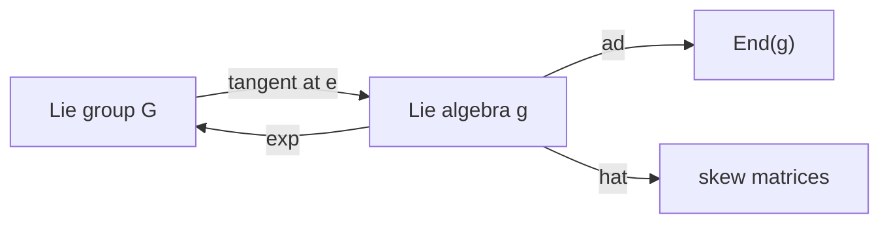

# Lie Algebras and $\mathfrak{so}(3)$

A Lie algebra is the **linear shadow of a symmetry group**. It keeps the
infinitesimal part of the group — the velocities of one-parameter families of
symmetries — and discards the global topology that makes the group hard to
compute with. In this repository the same object appears in three guises:

1. **Infinitesimal rotations.** The orientation of the rolling marble is an
   element of $SO(3)$; its angular velocity is an element of
   $\mathfrak{so}(3)$, and the hat map turns that velocity into the
   skew-symmetric matrix that differentiates a rotation.
2. **Infinitesimal diffeomorphisms.** The vector fields on the parameter plane
   form an infinite-dimensional Lie algebra under the commutator bracket. The
   torsion and curvature of a connection measure how the covariant derivative
   fails to be compatible with that bracket.
3. **The algebraic linearization of a group.** For any Lie group $G$, the
   tangent space at the identity, $T_eG$, carries a bracket, and the
   exponential map returns to $G$. The adjoint representation is the action of
   $G$ on its own Lie algebra.

This note is the algebraic companion to [`connections.md`](connections.md). The
categorical reading of the Lie-algebra adjunction is in
[`category-theory.md`](category-theory.md). The bracket of vector fields and
the torsion of a connection are Lie-algebraic objects, and the cross product on
$\mathbb{R}^3$ is the smallest interesting example. Everything below cites the
actual declarations in `lean/Brane/LieAlgebra.lean` (namespace `Brane.Lie`).

The Lean code does **not** reinvent Lie algebras. It instantiates Mathlib's
`LieRing` / `LieAlgebra` classes with the concrete vector space `Vec3` from
`Brane.DiffGeom`, and proves the axioms for the cross product. The only
background you need is: vector addition, scalar multiplication, and the cross
product.

> [!NOTE]
> **Where this sits.** `LieAlgebra.lean` imports `Brane.GeometricAlgebra` and
> Mathlib's Lie-algebra API. It is the last layer of the algebraic story:
> `DifferentialGeometry.lean` → `Shooting.lean` → `Connections.lean` →
> `ParallelTransport.lean` → `LieAlgebra.lean`. The orientation and angular
> velocity that use the same algebra are in
> [`game-math.md`](game-math.md) and [`ode-numerics.md`](ode-numerics.md).



---

## 1. The definition

> [!IMPORTANT]
> **Definition (Lie algebra).** A **Lie algebra** over a field is a vector
> space $L$ with a bilinear map $[\cdot,\cdot] : L \times L \to L$ (the
> *bracket*) that is
>
> * **alternating**: $[x,x] = 0$, equivalently $[x,y] = -[y,x]$;
> * satisfies the **Jacobi identity**:
>
> ```math
> [x,[y,z]] + [y,[z,x]] + [z,[x,y]] = 0.
> ```

Mathlib splits this into two classes. `LieRing` is the additive-group version,
with fields `add_lie`, `lie_add`, `lie_self`, and `leibniz_lie` (the last is
Jacobi in Leibniz form). `LieAlgebra R L` adds compatibility with scalar
multiplication, `lie_smul`.

The equivalent **Leibniz form** of Jacobi is the one that matters for
derivations:

```math
[x,[y,z]] = [[x,y],z] + [y,[x,z]].
```

> [!TIP]
> **Why two forms?** The cyclic sum is the textbook statement; the Leibniz
> form says "$\mathrm{ad}_x$ differentiates the bracket". The second is
> exactly what the connection Leibniz rule needs, so Lean proves that form and
> derives the first.

### Homomorphisms, subalgebras, ideals

The category $\mathbf{LieAlg}_{\mathbb{R}}$ has Lie algebras as objects and
**Lie-algebra homomorphisms** as morphisms:

```math
f([x,y]) = [f(x), f(y)].
```

A **subalgebra** is a linear subspace closed under the bracket; an **ideal** is
a subspace $I$ with $[L,I] \subseteq I$. Quotients $L/I$ inherit a bracket, and
the kernel of a homomorphism is an ideal. The **center** is the ideal

```math
Z(L) = \{x \in L : [x,y] = 0 \text{ for all } y \in L\}.
```

These definitions matter for two reasons. First, they make $\mathfrak{so}(3)$
provably **simple**: it has no ideals other than $0$ and itself (Exercise 1).
Second, the forgetful functor $\mathbf{LieAlg}_{\mathbb{R}} \to
\mathbf{Vect}_{\mathbb{R}}$ has a left adjoint, the universal enveloping
algebra $U$, which is the categorical home of the bracket's non-associativity
(Section 5).

### The Lie algebra of a Lie group

Let $G$ be a Lie group with identity $e$. A vector $A \in T_eG$ extends to a
unique **left-invariant vector field** $X_A$ by $X_A(g) = (L_g)_*A$. The
bracket of two such fields is again left-invariant, so it is $X_{[A,B]}$ for a
unique $[A,B] \in T_eG$. This bracket makes $T_eG$ a Lie algebra, denoted
$\mathfrak{g}$.

For a matrix group this is just the commutator:

```math
[A,B] = AB - BA.
```

For $G = SO(3)$, the identity component of the orthogonal group, the Lie
algebra is the space of skew-symmetric matrices:
$\mathfrak{so}(3) = \{A : A^{\mathsf T} = -A\}$. The hat map of Section 4 is
the explicit isomorphism between this matrix algebra and
$(\mathbb{R}^3, \times)$.

### The Lie algebra of vector fields

Let $\mathfrak{X}(M)$ be the smooth vector fields on a manifold. Composition of
derivations is associative, so the **commutator**

```math
[X,Y] = X \circ Y - Y \circ X
```

is again a derivation, hence a vector field. The Jacobi identity is automatic:
it is the associativity of composition written out. In coordinates,

```math
[X,Y]^i = X^j \partial_j Y^i - Y^j \partial_j X^i.
```

This is exactly `lieBracketParam` in `Brane.Connections`:

```lean
def lieBracketParam (X Y : ParamField) : ParamField :=
  fun p => dirDeriv Y p (X p) - dirDeriv X p (Y p)
```

The vector-field bracket is the infinite-dimensional Lie algebra behind
torsion, curvature, and the Lie derivative. It is the reason a connection is
not merely a family of derivatives: the derivatives must be compared with the
bracket.

> [!NOTE]
> **A useful slogan.** A Lie algebra is what remains of a symmetry group when
> you forget the group but remember how symmetries fail to commute.

---

## 2. The cross product on $\mathbb{R}^3$

For `Vec3` vectors $u, v$ (that is, $u, v \in \mathbb{R}^3$), define

```math
u \times v = (u_1 v_2 - u_2 v_1,\; u_2 v_0 - u_0 v_2,\; u_0 v_1 - u_1 v_0).
```

This is `Brane.DiffGeom.cross`, transported from Mathlib's `crossProduct` on
`Fin 3 → ℝ`. We register it as the bracket:

```lean
instance : Bracket Vec3 Vec3 := ⟨cross⟩
```

### The geometric picture

The vector $u \times v$ is the **oriented area vector** of the parallelogram
spanned by $u$ and $v$:

* it is perpendicular to both $u$ and $v$;
* its length is $\lVert u\rVert \lVert v\rVert \sin\theta$, the area;
* its direction is the right-hand rule.

Two consequences are used constantly in the geometry code:

```math
\lVert u \times v\rVert^2 + (u \cdot v)^2
= \lVert u\rVert^2 \lVert v\rVert^2,
\qquad
u \cdot (v \times w) = \det(u,v,w).
```

The first is Lagrange's identity; the second says the scalar triple product is
the oriented volume. In the repository, `inner_cross_left` and
`inner_cross_right` prove the perpendicularity, and `cross_coordinates`
unfolds the coordinate formula for the algebra below.

### The bracket laws

The bracket laws are proved by reducing to coordinates. Each line below is a
real theorem in the file:

| Law | Lean name | Statement |
| --- | --- | --- |
| additivity, left slot | `bracket_add_left` | $[u+u',v] = [u,v] + [u',v]$ |
| additivity, right slot | `bracket_add_right` | $[u,v+v'] = [u,v] + [u,v']$ |
| alternation | `bracket_self` | $[u,u] = 0$ |
| antisymmetry | `bracket_anticomm` | $[u,v] = -[v,u]$ |
| scalar linearity, left | `bracket_smul_left` | $[t\thinspace u,v] = t\thinspace [u,v]$ |
| scalar linearity, right | `bracket_smul_right` | $[u,t\thinspace v] = t\thinspace [u,v]$ |
| Jacobi | `bracket_jacobi` | $[u,[v,w]] + [v,[w,u]] + [w,[u,v]] = 0$ |
| Jacobi, Leibniz form | `bracket_leibniz` | $[u,[v,w]] = [[u,v],w] + [v,[u,w]]$ |

> [!NOTE]
> **How Jacobi is proved.** Rewrite with `cross_coordinates` and check the
> three coordinates with `fin_cases` and `ring`:
>
> ```lean
> theorem bracket_jacobi (u v w : Vec3) :
>     ⁅u, ⁅v, w⁆⁆ + ⁅v, ⁅w, u⁆⁆ + ⁅w, ⁅u, v⁆⁆ = 0 := by
>   change cross u (cross v w) + cross v (cross w u) + cross w (cross u v) = 0
>   rw [cross_coordinates, cross_coordinates, cross_coordinates, cross_coordinates,
>     cross_coordinates, cross_coordinates]
>   ext i
>   fin_cases i <;> simp [vec3] <;> ring
> ```
>
> Mathlib's `jacobi_cross` proves the same identity for the untransported
> product on `Fin 3 → ℝ`; the coordinate proof here avoids the `WithLp`
> transport.

The instances

```lean
instance crossLieRing : LieRing Vec3 where
  add_lie := Brane.GA.cross_add_left
  lie_add := Brane.GA.cross_add_right
  lie_self := Brane.GA.cross_self
  leibniz_lie := bracket_leibniz

instance crossLieAlgebra : LieAlgebra ℝ Vec3 where
  lie_smul := fun t x y => Brane.GA.cross_smul_right x t y
```

then make `Vec3` a genuine Lie algebra, with $[u,v] = u \times v$.

### Structure constants

Choose the standard basis $e_0 = (1,0,0)$, $e_1 = (0,1,0)$, $e_2 = (0,0,1)$.
The bracket is the Levi-Civita symbol:

```math
[e_i, e_j] = \sum_{k=0}^{2} \varepsilon_{ijk} e_k.
```

In table form:

| $[\cdot,\cdot]$ | $e_0$ | $e_1$ | $e_2$ |
| --- | --- | --- | --- |
| $e_0$ | $0$ | $e_2$ | $-e_1$ |
| $e_1$ | $-e_2$ | $0$ | $e_0$ |
| $e_2$ | $e_1$ | $-e_0$ | $0$ |

The three nonzero entries are proved as `cross_e0_e1`, `cross_e1_e2`, and
`cross_e2_e0` in `Brane.GeometricAlgebra`. The table is the smallest possible
nonabelian Lie algebra: every bracket is forced by these three products and
bilinearity.

### Jacobi is the failure of associativity, made coherent

The cross product is **not associative**:

```math
u \times (v \times w) \neq (u \times v) \times w
```

in general. The Leibniz form of Jacobi says exactly how it fails:

```math
[u,[v,w]] = [[u,v],w] + [v,[u,w]].
```

The left side is "multiply by $u$, then by $[v,w]$"; the right side is "multiply
by $[u,v]$, then by $w$, plus multiply by $v$, then by $[u,w]$". The bracket is
not an associative product, but the failure is itself controlled by the
bracket. This is the precise sense in which a Lie algebra is "associative up to
a derivation".

> [!WARNING]
> **Do not read $[u,v]$ as $uv - vu$ unless a product is already given.** The
> cross product is a Lie bracket, not an associative multiplication. The
> commutator formula $[A,B] = AB - BA$ is the *model*: it produces a Lie
> algebra from any associative algebra. The cross product is the same pattern
> in dimension three, where the Hodge dual identifies $\wedge^2\mathbb{R}^3$
> with $\mathbb{R}^3$.

### The Clifford and quaternion bridge

The geometric-algebra layer makes the last sentence literal. In
`Brane.GeometricAlgebra`, vectors embed into the Clifford algebra
$Cl(\mathbb{R}^3)$ and satisfy

```math
uv = \langle u,v\rangle + (u \times v)I,
```

where $I = e_0e_1e_2$ is the pseudoscalar and $I^2 = -1$
(`embed_mul_dual`, `I_sq`). Swapping $u$ and $v$ flips the sign of the cross
product, so

```math
uv - vu = 2(u \times v)I.
```

Thus the cross product is the commutator of two vectors in the Clifford
algebra, divided by $2I$; the Lean theorem is `Brane.Lie.embed_commutator`.
The even subalgebra of $Cl(\mathbb{R}^3)$ is the
quaternions; for pure imaginary quaternions the same formula reads

```math
uv = -u \cdot v + u \times v.
```

This is why the cross product, the quaternion product, and the Lie bracket of
$\mathfrak{so}(3)$ are three descriptions of one operation. The quaternion
update in [`ode-numerics.md`](ode-numerics.md) is the exponential of the same
Lie-algebra element that the cross product encodes. The categorical reading of
this paragraph — the Clifford algebra as a representing object, its grading,
the Hodge star, and the spin double cover — is Section 10 of
[`category-theory.md`](category-theory.md).

---

## 3. The adjoint action

> [!NOTE]
> **Definition (adjoint action).** For fixed $u$, the map
> $\mathrm{ad}_u : v \mapsto [u,v]$ is linear:

```lean
def crossAdjoint (u : Vec3) : Vec3 →ₗ[ℝ] Vec3 where
  toFun v := ⁅u, v⁆
  map_add' v w := Brane.GA.cross_add_right u v w
  map_smul' t v := Brane.GA.cross_smul_right u t v
```

The Jacobi identity says exactly that $\mathrm{ad}_u$ is a **derivation** of
the bracket:

```lean
theorem crossAdjoint_leibniz (u v w : Vec3) :
    crossAdjoint u ⁅v, w⁆ = ⁅crossAdjoint u v, w⁆ + ⁅v, crossAdjoint u w⁆ :=
  bracket_leibniz u v w
```

More than that: the assignment $u \mapsto \mathrm{ad}_u$ is itself a Lie-algebra
homomorphism. The bracket of two endomorphisms is their commutator, and Jacobi
is precisely the compatibility:

```lean
theorem crossAdjoint_lie (u v : Vec3) :
    crossAdjoint ⁅u, v⁆ =
      crossAdjoint u * crossAdjoint v - crossAdjoint v * crossAdjoint u := by
  apply LinearMap.ext
  intro w
  change ⁅⁅u, v⁆, w⁆ = ⁅u, ⁅v, w⁆⁆ - ⁅v, ⁅u, w⁆⁆
  rw [bracket_leibniz]
  abel
```

In abstract notation,

```math
\mathrm{ad} : L \to \mathfrak{gl}(L), \qquad
\mathrm{ad}([x,y]) = [\mathrm{ad}(x), \mathrm{ad}(y)].
```

This is the **adjoint representation**. Its kernel is the center $Z(L)$; for
$\mathfrak{so}(3)$ the center is zero, so $\mathrm{ad}$ is injective. Since both
sides have dimension three, it is an isomorphism onto its image.

### The group action behind it

Let $G$ be a Lie group with Lie algebra $\mathfrak{g}$. Conjugation,
$c_g(h) = ghg^{-1}$, fixes the identity, so its derivative at $e$ is a linear
map

```math
\mathrm{Ad}_g : \mathfrak{g} \to \mathfrak{g}.
```

This is the **adjoint action of the group**. Differentiating $g \mapsto
\mathrm{Ad}_g$ at the identity gives $\mathrm{ad}$. For $G = SO(3)$ and
$A = \widehat{u}$,

```math
\mathrm{Ad}_R(\widehat{u}) = R\widehat{u}R^{-1} = \widehat{Ru}.
```

The adjoint action on the Lie algebra is therefore the ordinary rotation action
on $\mathbb{R}^3$, transported through the hat map. This is a special feature
of dimension three: the adjoint representation and the defining representation
coincide. In higher dimensions they are different.

The orbit of a nonzero $u$ under $SO(3)$ is the sphere of radius
$\lVert u\rVert$; the stabilizer is a circle $S^1$ (the rotations about the
axis $u$). Hence

```math
SO(3)/S^1 \cong S^2.
```

This quotient is the geometric reason angular momentum lives on a sphere and
why every rotation has an axis. It is also the simplest example of a
**coadjoint orbit**, the symplectic leaves of the dual of a Lie algebra.

> [!TIP]
> **Why the adjoint action matters for the code.** The frame of the rolling
> marble is an orthonormal basis; a rotation of the frame acts on the angular
> velocity by the adjoint action. The identity
> $R\widehat{\omega}R^{-1} = \widehat{R\omega}$ is what lets the orientation
> update be written in world coordinates, which is exactly the convention in
> [`game-math.md`](game-math.md) and the quaternion update in
> [`ode-numerics.md`](ode-numerics.md).

---

## 4. The hat map and $\mathfrak{so}(3)$

> [!IMPORTANT]
> **Definition ($\mathfrak{so}(3)$).** The Lie algebra $\mathfrak{so}(3)$
> consists of the skew-symmetric $3 \times 3$ matrices. The **hat map** sends
> a vector to the matrix of cross product by that vector:

```lean
def hatMatrix (u : Vec3) : Matrix (Fin 3) (Fin 3) ℝ :=
  !![0, -u 2, u 1; u 2, 0, -u 0; -u 1, u 0, 0]
```

The defining property is that the matrix represents the cross product:

```lean
theorem hatMatrix_mulVec (u v : Vec3) :
    hatMatrix u *ᵥ v = cross u v
```

Two further facts connect it to the bracket:

* `hatMatrix_mem_so` — $\widehat{u}$ is skew-symmetric, so it lies in
  `LieAlgebra.Orthogonal.so (Fin 3) ℝ`;
* `hatMatrix_commutator` — $\widehat{[u,v]} = [\widehat{u},\widehat{v}]$,
  where the right-hand bracket is the matrix commutator
  $\widehat{u}\thinspace \widehat{v} - \widehat{v}\thinspace \widehat{u}$.

```lean
theorem hatMatrix_mem_so (u : Vec3) :
    hatMatrix u ∈ LieAlgebra.Orthogonal.so (Fin 3) ℝ := by
  rw [LieAlgebra.Orthogonal.mem_so]
  ext i j
  fin_cases i <;> fin_cases j <;> simp [hatMatrix]

theorem hatMatrix_commutator (u v : Vec3) :
    hatMatrix ⁅u, v⁆ = hatMatrix u * hatMatrix v - hatMatrix v * hatMatrix u := by
  change hatMatrix (cross u v) = hatMatrix u * hatMatrix v - hatMatrix v * hatMatrix u
  ext i j
  fin_cases i <;> fin_cases j <;>
    simp [hatMatrix, cross_coordinates, vec3] <;> ring
```

The hat map is therefore a Lie-algebra homomorphism from
$(\mathrm{Vec3}, \times)$ to $\mathfrak{so}(3)$. The full equivalence

```lean
noncomputable def so3MatrixEquiv :
    Vec3 ≃ₗ⁅ℝ⁆ LieAlgebra.Orthogonal.so (Fin 3) ℝ := by
  sorry
```

is stated and left as `sorry`; the missing work is the explicit inverse (read
off the entries $u_0 = A_{10}$, $u_1 = A_{02}$, $u_2 = A_{21}$ of a
skew-symmetric matrix) and the bracket-preservation proof, which follows from
`hatMatrix_commutator`.

> [!TIP]
> **Reading the inverse.** The matrix $\widehat{u}$ stores the three
> independent entries in the slots $A_{10}$, $A_{02}$, $A_{21}$. A
> skew-symmetric matrix has exactly those three degrees of freedom, which is
> why the hat map is an isomorphism onto $\mathfrak{so}(3)$ rather than merely
> an injection.

### The three matrices

Writing $L_i = \widehat{e_i}$ gives the standard basis of $\mathfrak{so}(3)$:

```math
L_0 = \begin{pmatrix} 0 & 0 & 0 \\ 0 & 0 & -1 \\ 0 & 1 & 0 \end{pmatrix},
\quad
L_1 = \begin{pmatrix} 0 & 0 & 1 \\ 0 & 0 & 0 \\ -1 & 0 & 0 \end{pmatrix},
\quad
L_2 = \begin{pmatrix} 0 & -1 & 0 \\ 1 & 0 & 0 \\ 0 & 0 & 0 \end{pmatrix}.
```

They satisfy

```math
[L_0,L_1] = L_2, \qquad [L_1,L_2] = L_0, \qquad [L_2,L_0] = L_1.
```

These are the infinitesimal rotations about the three coordinate axes. The
matrix $L_0$ rotates the $(y,z)$-plane; $L_1$ rotates the $(z,x)$-plane; $L_2$
rotates the $(x,y)$-plane. The commutation table is the structure-constant
table of Section 2, read in the matrix basis.

### The exponential map and Rodrigues' formula

The Lie group $SO(3)$ is the image of the matrix exponential restricted to
$\mathfrak{so}(3)$:

```math
\exp : \mathfrak{so}(3) \to SO(3), \qquad
\exp(\widehat{u}) = \sum_{n=0}^{\infty} \frac{\widehat{u}^{n}}{n!}.
```

Because $\widehat{u}^3 = -\lVert u\rVert^2 \widehat{u}$, the series collapses to
**Rodrigues' formula**. With $\theta = \lVert u\rVert$,

```math
\exp(\widehat{u})
= I + \frac{\sin\theta}{\theta}\widehat{u}
+ \frac{1-\cos\theta}{\theta^2}\widehat{u}^2,
```

and the limit $\theta \to 0$ is $I + \widehat{u}$. This is the precise sense in
which $\widehat{u}$ is an **infinitesimal rotation**: for small $u$,

```math
\exp(\widehat{u}) \approx I + \widehat{u}.
```

The axis of the rotation is $u/\theta$, and the angle is $\theta$. Every
rotation of $\mathbb{R}^3$ arises this way (Euler's theorem); the exponential
is surjective but not injective, because $\theta = 2\pi k$ gives the identity.
The ball $\lVert u\rVert \leq \pi$ is a convenient fundamental domain, with
antipodal points on the boundary identified.

> [!NOTE]
> **The angular-velocity dictionary.** If $R(t)$ is a smooth path in $SO(3)$,
> then $\dot{R}(t)R(t)^{-1}$ is skew-symmetric, so it is $\widehat{\omega(t)}$
> for a unique vector $\omega(t)$: the angular velocity in world coordinates.
> The orientation ODE is
>
> ```math
> \dot{R} = \widehat{\omega} R.
> ```
>
> In quaternion form this is the familiar
> $\dot{Q} = \tfrac12(0,\omega)Q$ used in
> [`ode-numerics.md`](ode-numerics.md) and [`game-math.md`](game-math.md). The
> update $\Delta Q = (\cos(\theta/2), \hat{\omega}\sin(\theta/2))$ is the
> quaternion exponential of the Lie-algebra element
> $\omega \Delta t$.

### The Killing form

The **Killing form** of a Lie algebra is the symmetric bilinear form

```math
B(x,y) = \mathrm{tr}(\mathrm{ad}_x \circ \mathrm{ad}_y).
```

For $\mathfrak{so}(3)$, the matrix of $\mathrm{ad}_u$ in the standard basis is
$\widehat{u}$, so

```math
B(u,v) = \mathrm{tr}(\widehat{u}\widehat{v}).
```

Using the identity $\widehat{u}\widehat{v} = v u^{\mathsf T} - (u \cdot v)I$,

```math
B(u,v) = u \cdot v - 3(u \cdot v) = -2(u \cdot v).
```

Thus the Killing form is $-2$ times the Euclidean metric. It is
**negative definite**, which is the algebraic signature of compactness: a Lie
algebra is compact exactly when its Killing form is negative definite. The
same computation shows that $\mathfrak{so}(3)$ is semisimple (the form is
nondegenerate) and, because it has no nontrivial ideals, simple.

> [!TIP]
> **Why $-2$?** The trace of $\widehat{u}\widehat{v}$ counts the three
> coordinate planes. The identity $\widehat{u}\widehat{v} = v u^{\mathsf T} -
> (u \cdot v)I$ gives the eigenvalues $0$, $-(u \cdot v)$, and
> $-(u \cdot v)$, whose sum is $-2(u \cdot v)$.

### The complex picture and the double cover

Over the complex numbers the picture simplifies:

```math
\mathfrak{so}(3)_{\mathbb{C}} \cong \mathfrak{sl}(2,\mathbb{C}).
```

A concrete isomorphism uses the Pauli matrices
$\sigma_0,\sigma_1,\sigma_2$:

```math
\rho(u) = -\frac{i}{2}(u_0\sigma_0 + u_1\sigma_1 + u_2\sigma_2),
\qquad
[\rho(u),\rho(v)] = \rho(u \times v).
```

At the group level, the corresponding map is the double cover

```math
SU(2) \to SO(3),
```

with kernel $\{\pm I\}$. A full $2\pi$ rotation is $-I$ in $SU(2)$, not the
identity: this is the algebraic origin of spinors and of the "720 degrees"
behaviour of fermions. The unit quaternions $S^3$ are a third model of
$SU(2)$, and the quaternion update in the code is the exponentiated version of
this cover.

> [!WARNING]
> **A common confusion.** The cross product is *not* the Lie bracket of
> $\mathfrak{su}(2)$ as a real Lie algebra until you choose an isomorphism.
> The real Lie algebras $\mathfrak{so}(3)$ and $\mathfrak{su}(2)$ are
> isomorphic, but their complexifications and their representations are
> usually presented with different conventions (Hermitian versus
> skew-symmetric matrices, Pauli matrices versus $L_i$). The formula
> $\rho(u)$ above is one explicit bridge.

---

## 5. Mathlib's matrix Lie algebras

The file also records the dictionary with Mathlib:

| Object | Mathlib name | Lean restatement |
| --- | --- | --- |
| bracket on matrices | $[A,B] = AB - BA$ | `matrix_bracket_eq_commutator` |
| special linear Lie algebra | `LieAlgebra.SpecialLinear.sl` | `mem_sl_iff` |
| orthogonal Lie algebra | `LieAlgebra.Orthogonal.so` | `mem_so_iff` |
| derivations | `Derivation` | `derivation_leibniz` |

```lean
theorem matrix_bracket_eq_commutator (A B : Matrix (Fin 3) (Fin 3) ℝ) :
    ⁅A, B⁆ = A * B - B * A :=
  rfl

theorem mem_so_iff (A : Matrix (Fin 3) (Fin 3) ℝ) :
    A ∈ LieAlgebra.Orthogonal.so (Fin 3) ℝ ↔ Aᵀ = -A :=
  LieAlgebra.Orthogonal.mem_so (Fin 3) ℝ A

theorem mem_sl_iff (A : Matrix (Fin 3) (Fin 3) ℝ) :
    A ∈ LieAlgebra.SpecialLinear.sl (Fin 3) ℝ ↔ A.trace = 0 := by
  simp [LieAlgebra.SpecialLinear.sl]

theorem derivation_leibniz {A : Type*} [CommRing A] [Algebra ℝ A]
    (D : Derivation ℝ A A) (a b : A) :
    D (a * b) = a • D b + b • D a :=
  D.leibniz a b
```

So `Vec3` with the cross product is the same Lie algebra as
$\mathfrak{so}(3)$, and $\mathfrak{sl}(3)$ / $\mathfrak{so}(3)$ are available
from Mathlib whenever a matrix model is more convenient than the coordinate
model.

### The universal enveloping algebra

Every associative algebra $A$ becomes a Lie algebra with the commutator
bracket. This gives a forgetful functor

```math
\mathbf{Alg}_{\mathbb{R}} \to \mathbf{LieAlg}_{\mathbb{R}}.
```

Its left adjoint is the **universal enveloping algebra** $U(L)$: the free
associative algebra on $L$ subject to the relations

```math
xy - yx = [x,y].
```

The universal property is that every Lie-algebra homomorphism $L \to A$ into an
associative algebra extends uniquely to an algebra homomorphism $U(L) \to A$.
Mathlib's `UniversalEnvelopingAlgebra.lift` is this statement. For
$\mathfrak{so}(3)$, $U(\mathfrak{so}(3))$ is the algebra generated by
$L_0,L_1,L_2$ with the commutation relations of Section 4; its representation
theory is the representation theory of angular momentum.

> [!NOTE]
> **Why the enveloping algebra is the right "fix".** The bracket is not
> associative, so it cannot be composition in a one-object category. The
> enveloping algebra is the universal associative algebra in which the bracket
> *becomes* the commutator. This is the categorical content of the adjunction
> in [`category-theory.md`](category-theory.md).

---

## 6. Vector fields, torsion, and curvature

The bracket of vector fields is the infinite-dimensional Lie algebra that
connects this note to [`connections.md`](connections.md). An affine connection
$\nabla$ differentiates vector fields, but it is not a Lie-algebra
homomorphism: the two operations "bracket" and "covariant derivative" do not
commute. The two obstructions are the torsion and the curvature:

```math
T(X,Y) = \nabla_X Y - \nabla_Y X - [X,Y],
```

```math
R(X,Y)Z = \nabla_X\nabla_Y Z - \nabla_Y\nabla_X Z - \nabla_{[X,Y]}Z.
```

The Lean declarations are in `Brane.Connections`:

```lean
def torsion (D : AffineConnection) (X Y : ParamField) : ParamField :=
  fun p => D.cov X Y p - D.cov Y X p - lieBracketParam X Y p

def curvature (D : AffineConnection) (X Y Z : ParamField) : ParamField :=
  fun p => D.cov X (D.cov Y Z) p - D.cov Y (D.cov X Z) p -
    D.cov (lieBracketParam X Y) Z p
```

The torsion measures the failure of the infinitesimal parallelogram to close:
if you parallel transport along $X$ then $Y$, and compare with $Y$ then $X$,
the gap is $T(X,Y)$. The curvature measures the failure of parallel transport
around a small loop to return to the starting vector. In the language of
[`category-theory.md`](category-theory.md), curvature is the obstruction to
the transport functor being flat.

There is a Lie-algebraic way to say the same thing. A connection is a
$\mathfrak{g}$-valued 1-form $\omega$ on the frame bundle, and its curvature is

```math
\Omega = d\omega + \tfrac12[\omega,\omega],
```

the **Cartan structure equation**. The bracket in this formula is the Lie
bracket of the structure group: $\mathfrak{so}(3)$ for a spatial frame,
$\mathfrak{so}(2)$ for the oriented tangent frame of a surface, and
$\mathfrak{se}(3)$ for rigid motions. The Jacobi identity is what makes the
expression consistent; the Bianchi identity is its derivative.

> [!NOTE]
> **Which structure group?** The graph surface has a two-dimensional tangent
> plane, so its oriented orthonormal frame bundle has structure group
> $SO(2)$. The rolling marble has a three-dimensional orientation, so its
> frame bundle has structure group $SO(3)$. The Lie algebra in this note is
> the $SO(3)$ one; the $SO(2)$ analogue is the abelian Lie algebra
> $\mathbb{R}$ with the zero bracket, which is why planar rotations commute.

The Jacobi identity for $[X,Y]$ is also the infinitesimal **Bianchi identity**:
for a torsion-free connection, the cyclic sum of $R$ vanishes,

```math
R(X,Y)Z + R(Y,Z)X + R(Z,X)Y = 0.
```

This is the geometric face of the same algebraic identity that makes
$\mathrm{ad}$ a Lie-algebra homomorphism.

---

## 7. Where $\mathfrak{so}(3)$ appears in this repository

| Place | Object | Lie-algebraic reading |
| --- | --- | --- |
| `Brane.Lie.crossLieAlgebra` | $(\mathbb{R}^3, \times)$ | the concrete Lie algebra |
| `Brane.Lie.crossAdjoint` | $v \mapsto u \times v$ | the adjoint action |
| `Brane.Lie.crossAdjoint_lie` | $\mathrm{ad}([u,v]) = [\mathrm{ad}(u),\mathrm{ad}(v)]$ | $\mathrm{ad}$ is a representation |
| `Brane.Lie.hatMatrix` | $\widehat{u}$ | the matrix of $\mathrm{ad}_u$ |
| `Brane.Lie.hatMatrix_mulVec` | $\widehat{u}v = u \times v$ | defining = adjoint in 3D |
| `Brane.Lie.hatMatrix_commutator` | $\widehat{[u,v]} = [\widehat{u},\widehat{v}]$ | Lie homomorphism |
| `Brane.Lie.embed_commutator` | $[\mathrm{embed}(u),\mathrm{embed}(v)] = 2(u \times v)I$ | Clifford commutator is the bracket |
| `Brane.Lie.so3MatrixEquiv` | $\mathbb{R}^3 \cong \mathfrak{so}(3)$ | the matrix model |
| `Brane.Connections.lieBracketParam` | $[X,Y]$ | the vector-field Lie algebra |
| `Brane.Connections.torsion` | $T(X,Y)$ | failure of $\nabla$ to match the bracket |
| `Brane.Connections.curvature` | $R(X,Y)Z$ | failure of $\nabla$ to commute |
| `Brane.GamePhysics.angularVelocity` | $\omega$ | an element of $\mathfrak{so}(3)$ |
| `Brane.GamePhysics` quaternion update | $\Delta Q$ | the exponential of $\omega \Delta t$ |

The table is the short answer to "where does the Lie algebra actually enter the
code?". The cross product is the computational model; the hat map is the
matrix model; the adjoint action is the change-of-frame rule; torsion and
curvature are the vector-field model; the quaternion update is the group
exponential.

---

## 8. Proven vs. declared

| Result | Lean name | Status |
| --- | --- | --- |
| Bracket additivity | `bracket_add_left/right` | proved |
| Alternation | `bracket_self`, `bracket_anticomm` | proved |
| Scalar linearity | `bracket_smul_left/right` | proved |
| Jacobi identity | `bracket_jacobi` | proved |
| Leibniz form of Jacobi | `bracket_leibniz` | proved |
| `LieRing` instance | `crossLieRing` | proved |
| `LieAlgebra` instance | `crossLieAlgebra` | proved |
| Adjoint is a derivation | `crossAdjoint_leibniz` | proved |
| Adjoint is a Lie homomorphism | `crossAdjoint_lie` | proved |
| Hat matrix represents cross product | `hatMatrix_mulVec` | proved |
| Hat matrix is skew | `hatMatrix_mem_so` | proved |
| Hat respects commutator | `hatMatrix_commutator` | proved |
| Clifford commutator is the cross product | `embed_commutator` | proved |
| $\mathrm{Vec3} \cong \mathfrak{so}(3)$ | `so3MatrixEquiv` | `sorry` |
| Rodrigues' formula | — | not yet |
| Killing form $-2\langle\cdot,\cdot\rangle$ | — | not yet |
| $\mathfrak{so}(3)$ is simple | — | not yet |
| Quaternion double cover | — | not yet |

The single `sorry` in the Lie-algebra file is the explicit equivalence with
Mathlib's bundled $\mathfrak{so}(3)$: the homomorphism half is already proved,
and the inverse is the entry-reading map described in §4. The other
"not yet" rows are either standard identities that would be routine to
formalize (Rodrigues, the Killing form) or belong to a group-level development
that the repository does not yet contain (the double cover).

---

## 9. Cheat sheet: file ↔ concept

| `Brane/LieAlgebra.lean` | Plain-language description | Built from |
| --- | --- | --- |
| `Bracket Vec3 Vec3` | the cross product, used as the Lie bracket | `DiffGeom.cross` |
| `bracket_jacobi` | the cross product satisfies Jacobi | coordinates + `ring` |
| `bracket_leibniz` | Jacobi as a derivation rule | `bracket_jacobi` |
| `crossLieRing` | `Vec3` is a Lie ring | the bracket laws |
| `crossLieAlgebra` | `Vec3` is a real Lie algebra | `cross_smul_right` |
| `crossAdjoint u` | the linear map $v \mapsto [u,v]$ | `cross_add_right`, `cross_smul_right` |
| `crossAdjoint_leibniz` | $\mathrm{ad}_u$ is a derivation | `bracket_leibniz` |
| `crossAdjoint_lie` | $\mathrm{ad}$ is a Lie homomorphism | Jacobi + `abel` |
| `hatMatrix u` | the skew-symmetric matrix of $u$ | matrix literal |
| `hatMatrix_mulVec` | $\widehat{u}v = u \times v$ | coordinates |
| `hatMatrix_mem_so` | its image lies in $\mathfrak{so}(3)$ | entry check |
| `hatMatrix_commutator` | hat turns $\times$ into the matrix commutator | entry check |
| `embed_commutator` | Clifford commutator recovers $\times$ | `embed_mul_dual` + `noncomm_ring` |
| `so3MatrixEquiv` | $\mathrm{Vec3} \cong \mathfrak{so}(3)$ | `sorry` |

---

## 10. Open questions and exercises

1. **Simplicity of $\mathfrak{so}(3)$.** Let $I \neq 0$ be an ideal and pick
   $u \in I$ nonzero. Show that $u \times v \in I$ for every $v$, so $I$
   contains the plane perpendicular to $u$. Then show that
   $u \times (u \times v)$ recovers $u$, so $I = \mathfrak{so}(3)$. This is the
   cleanest proof that the Lie algebra is simple, and it uses only the cross
   product.
2. **The Killing form.** Verify
   $\widehat{u}\widehat{v} = v u^{\mathsf T} - (u \cdot v)I$ and conclude
   $B(u,v) = -2(u \cdot v)$. Which step fails in dimension $n \neq 3$?
3. **Rodrigues.** Prove the series collapse
   $\widehat{u}^3 = -\lVert u\rVert^2\widehat{u}$ and derive the formula for
   $\exp(\widehat{u})$. Where is the identity
   $\widehat{u}^2 = u u^{\mathsf T} - \lVert u\rVert^2 I$ used?
4. **Equivariance.** Show $R\widehat{u}R^{-1} = \widehat{Ru}$ for
   $R \in SO(3)$. Conclude that the adjoint action of $SO(3)$ on
   $\mathfrak{so}(3)$ is the defining action on $\mathbb{R}^3$.
5. **The double cover.** Show that $\exp : \mathfrak{so}(3) \to SO(3)$ is
   surjective but not injective, and identify the kernel. Why is $SU(2)$
   simply connected while $SO(3)$ is not?
6. **The isometry Lie algebra of a graph.** A Killing field $X$ on a
   Riemannian manifold satisfies $\mathcal{L}_X g = 0$. For the graph metric
   `gramMatrix h`, compute the Killing fields of the plane and of the round
   sphere in stereographic coordinates. What is the Lie algebra of the
   isometry group of a generic graph?
7. **The Euler–Poincaré picture.** For a Lie group $G$ with a left-invariant
   metric, the geodesic equation reduces to an equation on $\mathfrak{g}$.
   Derive it for $SO(3)$ with the Killing form and compare with the rigid-body
   equations. This is the group-theoretic analogue of the shooting method.
8. **The infinite-dimensional case.** The Lie algebra of the diffeomorphism
   group is $\mathfrak{X}(M)$. The Lie algebra of the volume-preserving
   diffeomorphism group is the divergence-free vector fields. The Euler
   equation of an ideal fluid is the geodesic equation on that group (Arnold's
   theorem). Why does the finite-dimensional Killing-form argument not apply?

---

## References

### Primary encyclopedia articles

* Wikipedia, [Lie algebra](https://en.wikipedia.org/wiki/Lie_algebra)
* Wikipedia, [Lie bracket of vector fields](https://en.wikipedia.org/wiki/Lie_bracket_of_vector_fields)
* Wikipedia, [Adjoint representation](https://en.wikipedia.org/wiki/Adjoint_representation)
* Wikipedia, [Special orthogonal Lie algebra](https://en.wikipedia.org/wiki/Orthogonal_Lie_algebra)
* Wikipedia, [Derivation (differential algebra)](https://en.wikipedia.org/wiki/Derivation_(differential_algebra))
* Wikipedia, [Killing form](https://en.wikipedia.org/wiki/Killing_form)
* Wikipedia, [Rodrigues' rotation formula](https://en.wikipedia.org/wiki/Rodrigues%27_rotation_formula)
* Wikipedia, [Quaternions and spatial rotation](https://en.wikipedia.org/wiki/Quaternions_and_spatial_rotation)

### Wolfram MathWorld

* [Lie Algebra](https://mathworld.wolfram.com/LieAlgebra.html)
* [Lie Bracket](https://mathworld.wolfram.com/LieBracket.html)
* [Adjoint Representation](https://mathworld.wolfram.com/AdjointRepresentation.html)
* [Special Orthogonal Group](https://mathworld.wolfram.com/SpecialOrthogonalGroup.html)
* [Killing Form](https://mathworld.wolfram.com/KillingForm.html)

### nLab

* [Lie algebra](https://ncatlab.org/nlab/show/Lie+algebra)
* [Lie bracket](https://ncatlab.org/nlab/show/Lie+bracket)
* [adjoint action](https://ncatlab.org/nlab/show/adjoint+action)
* [Killing form](https://ncatlab.org/nlab/show/Killing+form)
* [universal enveloping algebra](https://ncatlab.org/nlab/show/universal+enveloping+algebra)
* [Lie group](https://ncatlab.org/nlab/show/Lie+group)

### Encyclopedia of Mathematics

* [Lie algebra](https://encyclopediaofmath.org/wiki/Lie_algebra)
* [Lie algebra, universal enveloping](https://encyclopediaofmath.org/wiki/Universal_enveloping_algebra)
* [Killing form](https://encyclopediaofmath.org/wiki/Killing_form)

### Free books and lecture notes

* A. Kirillov, *Introduction to Lie Groups and Lie Algebras* —
  <https://www.math.stonybrook.edu/~kirillov/mat552/liegroups.pdf>
* H. Samelson, *Notes on Lie Algebras* —
  <https://pi.math.cornell.edu/~hatcher/Other/Samelson-LieAlg.pdf>
* P. Etingof, *Lie Groups and Lie Algebras II* (MIT 18.755, 2024) —
  <https://ocw.mit.edu/courses/18-755-lie-groups-and-lie-algebras-ii-spring-2024/mit18_755_s24_lec_full.pdf>
* E. Belmont, *A Course on Lie Algebras and their Representations* —
  <https://mathweb.ucsd.edu/~ebelmont/lie-notes.pdf>
* K. Erdmann and M. Wildon, *Introduction to Lie Algebras*, Springer
  Undergraduate Mathematics Series, 2006.
* J. E. Humphreys, *Introduction to Lie Algebras and Representation Theory*,
  Graduate Texts in Mathematics 9, Springer, 1972.
* W. Fulton and J. Harris, *Representation Theory: A First Course*, Graduate
  Texts in Mathematics 129, Springer, 1991.
* J.-P. Serre, *Lie Algebras and Lie Groups*, Lecture Notes in Mathematics 1500,
  Springer, 1992.
* B. C. Hall, *Lie Groups, Lie Algebras, and Representations*, 2nd ed.,
  Graduate Texts in Mathematics 222, Springer, 2015.
* J. Stillwell, *Naive Lie Theory*, Undergraduate Texts in Mathematics,
  Springer, 2008.
* T. Needham, *Visual Complex Analysis*, Oxford University Press, 1997 — the
  quaternion and rotation chapters are a good geometric companion.

### Papers

* W. Magnus, "Über Gruppen und Ideale in Lieschen Ringen",
  *J. Reine Angew. Math.* **177** (1937), 105–113.
* C. Chevalley and S. Eilenberg, "Cohomology theory of Lie groups and Lie
  algebras", *Trans. Amer. Math. Soc.* **63** (1948), 85–124.
* H. Munthe-Kaas and A. Lundervold, "On post-Lie algebras, Lie–Butcher
  series and post-Lie algebra valued flows", *SIAM J. Appl. Algebra Geom.*
  **4** (2020), 356–392. DOI: [10.1137/19M1252879](https://doi.org/10.1137/19M1252879)
* V. I. Arnold, "Sur la géométrie différentielle des groupes de Lie de
  dimension infinie et ses applications à l'hydrodynamique des fluides
  parfaits", *Ann. Inst. Fourier* **16** (1966), 319–361.
* J. E. Marsden and T. S. Ratiu, *Introduction to Mechanics and Symmetry*,
  2nd ed., Texts in Applied Mathematics 17, Springer, 1999.

See [`../bibtex.md`](../bibtex.md) for the human-readable link list and
[`../references.bib`](../references.bib) for the BibTeX entries.
