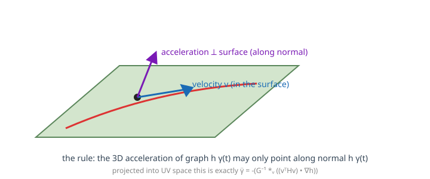
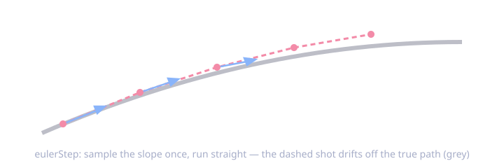
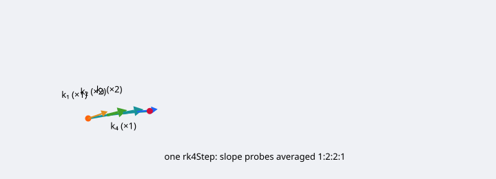

# Shooting Geodesics for Dummies (a 3D graphics programmer's edition)

You know heights, normals, UVs, and physics integrators from games.
Good news: the "shooting method" in `lean/Brane/Shooting.lean` is just
**rolling a marble across a heightmap with an unusual physics rule**.

Everything below cites the actual Lean code. All definitions live in the
namespace `Brane.Shoot` (file `lean/Brane/Shooting.lean`) and the geometry
they are built from lives in `Brane.DiffGeom` (file
`lean/Brane/DifferentialGeometry.lean`).

---

## 1. The surface is a heightmap — you already know this

In graphics, a heightmap is a grid of heights over a UV plane. Here it's the
continuous version. In `DifferentialGeometry.lean`:

```lean
def graph (h : ℝ → ℝ → ℝ) (p : ℝ × ℝ) : Vec3 :=
  vec3 p.1 p.2 (h p.1 p.2)
```

Same thing as a displaced mesh, no LOD, infinite subdivision. The mapping to
engine concepts, with the exact Lean names:

| Game engine | Lean | Definition |
|---|---|---|
| UV space | parameter plane `ℝ²`, coordinates `p : ℝ × ℝ` | the domain of `h` |
| heightmap texture | `h : ℝ → ℝ → ℝ` | sampled by `partialX h x y = deriv (fun t => h t y) x` etc. |
| displaced mesh | `graph h p = (x, y, h x y)` | `DiffGeom.graph` |
| mesh tangents (U and V edge directions) | `tangentX h p = (1, 0, ∂ₓh)`, `tangentY h p = (0, 1, ∂ᵧh)` | `DiffGeom.tangentX`, `tangentY` |
| vertex normal | `normal h p = cross (tangentX h p) (tangentY h p)` | `DiffGeom.normal` |

> [!NOTE]
> **Definition (σ, the surface map).** Throughout this document we write
>
> ```text
> σ := graph h,  i.e.  σ(p) = (p.1, p.2, h p.1 p.2),
> ```
>
> for the parametrized surface `ℝ² → ℝ³` (`DiffGeom.graph`). A UV path
> `γ : ℝ → ℝ²` then lifts to the 3D curve `σ ∘ γ` — the marble's actual
> position on the mesh. The embedding map `σ` is the one whose derivatives
> (`∂ₓσ = tangentX h p`, `∂ᵧσ = tangentY h p`) appear in every formula below.

Some facts are already *proved* in `DifferentialGeometry.lean`, and they are
the ones a shooter cares about:

> [!NOTE]
> **Lemma (DiffGeom.normal_eq, DiffGeom.normal_ne_zero).**
> `normal h p = (-∂ₓh, -∂ᵧh, 1)`. In particular the normal is never zero:
> its z-component is always `1`.

> [!NOTE]
> **Lemma (DiffGeom.norm_sq_normal).**
> `‖normal h p‖² = 1 + (∂ₓh)² + (∂ᵧh)²` — the heightmap slope stretches the
> mesh, exactly like a displaced-grid area scale factor.

> [!NOTE]
> **Lemma (DiffGeom.norm_sq_tangentX).**
> `‖tangentX h p‖² = 1 + (∂ₓh)²` — the U edge of the quad gets longer as
> the slope grows.


> [!IMPORTANT]
> **Key point for everything that follows:** the whole simulation runs in
> the **UV plane**. We never integrate in 3D; we integrate `(x(t), y(t))`
> and evaluate `h` to get the 3D point. Exactly like simulating a vehicle
> on a heightfield: cheap 2D state, 3D render.

### 1.1 Notation

The following notational conventions are fixed here and used throughout the
remainder of this document without further remark.

> [!NOTE]
> **Vectors as functions.** In Lean, a 2-dimensional real vector is not a
> pair of floats but a *function* from the two-element index type `Fin 2`
> to `ℝ`:
>
> ```lean
> abbrev Vel2 : Type := Fin 2 → ℝ   -- DiffGeom.Vel2
> ```
>
> An element `v : Vel2` is written `v`; its components are the function
> values `v 0` and `v 1`. In ordinary mathematical notation we write
> `v = (v₀, v₁)` with `v₀ := v 0` and `v₁ := v 1`. In prose we use `v₀, v₁`;
> when quoting Lean verbatim we use `v 0, v 1`.

> [!IMPORTANT]
> **Notation table.** The following notations appear in the Lean sources
> and are never re-explained at their use sites.
>
> | Notation | Lean name | Meaning |
> |---|---|---|
> | `r • x` | `SMul.smul` | scalar multiplication `r·x` of a real number `r` with a vector/matrix `x` |
> | `M *ᵥ v` | `Matrix.mulVec` | matrix–vector product `M·v` (`M` acts on the column vector `v`) |
> | `u ⬝ᵥ v` | `Matrix.dotProduct` | the dot product `Σᵢ uᵢ vᵢ` of two vectors |
> | `![a, b]` | `Matrix.vecCons` literal | the vector `(a, b)` as a function `Fin 2 → ℝ`; more generally `![a, b, c]` a 3-vector |
> | `!![a, b; c, d]` | `Matrix.of` literal | the 2×2 matrix with rows `(a, b)` and `(c, d)` |
> | `p.1`, `p.2` | `Prod.fst`, `Prod.snd` | the coordinates of `p : ℝ × ℝ`, i.e. `x` and `y` |
> | `⟪u, v⟫` | `inner` | the Euclidean inner product (same value as `u ⬝ᵥ v`) |

> [!TIP]
> **Reading example.** The combination that `jacobian_mulVec` proves the
> Jacobian produces,
>
> ```lean
> v 0 • tangentX h p + v 1 • tangentY h p
> ```
>
> reads, in strict mathematical notation, as
>
> ```text
> v₀ · ∂ₓσ(p) + v₁ · ∂ᵧσ(p),
> ```
>
> where `v₀ = v 0` and `v₁ = v 1` are the components of the UV velocity
> `v`, `•` is scalar multiplication, and the sum is the corresponding
> tangent vector — the familiar "local-to-world transform of a 2D velocity
> through the mesh Jacobian".

---

## 2. The weird physics rule

> [!IMPORTANT]
> **Definition (geodesic).** The acceleration of the 3D point must point
> exactly along the surface normal. Nothing else. No gravity, no friction —
> just "stay glued to the surface". A curve obeying this rule is called a
> **geodesic**.

Intuition: the path a stretched rubber band takes when pinned at both ends
and pressed onto the surface; or the path you'd walk on the terrain feeling
no *turning* force, only the surface curving under your feet.

### From the rule to a formula, in four steps (all matrices)

Let `γ(t) = (x(t), y(t))` be the UV path, `v = γ̇` its UV velocity, and
`γ̈` its UV acceleration. Differentiating the lifted curve `σ ∘ γ`, i.e.
`graph h (γ(t))` (see the definition of `σ` in §1), twice gives the
3D acceleration of the marble:

```text
(σ ∘ γ)'' = J γ̈ + (vᵀ H v) · e₃
```

where (all from `DifferentialGeometry.lean`):

- `J = jacobian h p` is the 3×2 Jacobian whose columns are the mesh
  tangents — `DiffGeom.jacobian_mulVec` proves that acting on the UV
  velocity it produces the tangent combination
  `v₀ · tangentX h p + v₁ · tangentY h p` (with `v₀ = v 0`, `v₁ = v 1`
  and `•` scalar multiplication, see the notation table in §1);
- `H = hessian h p = [[∂ₓₓh, ∂ₓᵧh], [∂ᵧₓh, ∂ᵧᵧh]]` is the second-derivative
  texture — the `jacobianTangentX` / `jacobianTangentY` matrices are exactly
  its rows padded into 3×2 form (`jacobianTangentX_apply`,
  `jacobianTangentY_apply`);
- `e₃` is the vertical direction (the height direction of the heightmap).

"Geodesic" means this 3D acceleration has **no tangential part** — it must be
parallel to `normal h p`. The tangential part is found by dotting with the
two mesh tangents, and `tangentX_inner_normal` / `tangentY_inner_normal`
already prove those dots kill anything along the normal. So the rule
becomes, purely in UV space:

```text
G γ̈ + (vᵀ H v) ∇h = 0
```

with `G = Jᵀ J` the Gram matrix (`gramMatrix_eq_transpose_mul` proves
exactly this in Lean: `gramMatrix h p = (jacobian h p)ᵀ * jacobian h p`)
and `∇h = (∂ₓh, ∂ᵧh)`. Solve for `γ̈` by multiplying with `G⁻¹`:

```lean
def geoAccel (h : ℝ → ℝ → ℝ) (p : ℝ × ℝ) (v : Vel2) : Vel2 :=
  -((gramMatrix h p)⁻¹ *ᵥ (hessQuad h p v • gradientVec h p))
```

That is the *entire* geodesic equation: one dot product, one scalar-times-
vector, one matrix–vector product. No Christoffel symbols, no index tensors —
if you can multiply a matrix by a vector, you can integrate this.

The two building blocks, verbatim from `Shooting.lean`:

```lean
/-- The parameter gradient of `h`: the vector `(∂₀h, ∂₁h) = (partialX, partialY)`,
written with the `![·, ·]` vector literal. -/
def gradientVec (h : ℝ → ℝ → ℝ) (p : ℝ × ℝ) : Vel2 :=
  ![partialX h p.1 p.2, partialY h p.1 p.2]

/-- The Hessian quadratic form `vᵀ H v`: the second derivative of `h` along
the parameter velocity `v`, as a dot product `v ⬝ᵥ (H · v)`. -/
def hessQuad (h : ℝ → ℝ → ℝ) (p : ℝ × ℝ) (v : Vel2) : ℝ :=
  v ⬝ᵥ (hessian h p *ᵥ v)
```

Read `geoAccel` like a shader:

| Symbol | Meaning | Where it comes from |
|---|---|---|
| `∇h = (∂ₓh, ∂ᵧh)` | gradient of the heightmap at the ball's UV | `gradientVec` — like sampling the height gradient |
| `H` | Hessian `[[h_xx, h_xy], [h_yx, h_yy]]` | `hessian` — second derivative texture |
| `vᵀ H v` | how much the surface curves *along the direction you're moving* | `hessQuad` — directional curvature |
| `G = JᵀJ` | Gram matrix — how the UV plane is stretched onto the surface | `gramMatrix` |
| `G⁻¹` | un-stretch: convert "surface constraints" back to UV space | `Matrix.inv` |

In words: *"the surface curves away under me by amount `vᵀHv`; reproject that
correction through the UV distortion `G⁻¹` and steer against it."*



### Are geodesics just straight lines in UV? (the honest answer)

**Only if the heightmap is a perfect plane.** The curvature of the UV path
comes entirely from `hessQuad = vᵀHv`:

> [!NOTE]
> **Degenerate case (the plane).** If `h(x, y) = a·x + b·y + c`, Lean
> already proves all second partials are zero (`partialXX_planeHeight`,
> `partialXY_planeHeight`, `partialYY_planeHeight`), so `H = 0`,
> `hessQuad = 0`, and `geoAccel = 0` for *every* velocity. The UV path is
> `pos += dt * vel` forever: straight lines in UV, straight in 3D.

On any real heightmap, `vᵀHv` is generally nonzero, so `geoAccel ≠ 0`
and the UV velocity genuinely turns as it rolls.

The mental model: **the UV plane is a distorted map of the surface**, like an
equirectangular map of Earth. Great-circle flight routes are perfectly
"straight" on the globe but draw as curved arcs on the flat map, because the
map stretches distances differently at different latitudes. Same here: the
metric `G = JᵀJ` stretches UV space wherever the slope is steep
(`det G = 1 + |∇h|²` from `det_gramMatrix_eq` is exactly the stretch
factor), and the geodesic bends in UV precisely **to stay as straight as
possible on the actual surface**. Flat slope along travel → little
distortion → nearly straight UV path. Strong curvature along travel
(`vᵀHv` large) → strong bending.

> [!TIP]
> **Concrete example, straight out of Lean.** The paraboloid
> `bowlHeight x y = x² + y²` has `partialXX = partialYY = 2` (proved in
> `DifferentialGeometry.lean`), so `H = 2I` and `vᵀHv = 2‖v‖²` — nonzero
> for every nonzero velocity. A shot across the bowl curves in UV even on
> this perfectly symmetric surface.

> [!WARNING]
> **Terminology trap.** "Straight" always means *intrinsic* (zero
> tangential acceleration), never a straight line in ℝ³ — on a curved
> surface a geodesic cannot be a straight 3D line; it just wiggles
> vertically with `h` while being as straight as the surface allows. If
> UV paths were straight lines, `shoot` would be a raycast; the whole
> point of `geoAccel` is that the UV velocity must be steered, one small
> time step at a time.


---

## 2.5 Where the formula comes from: differentiate twice

The equation `(σ ∘ γ)'' = J γ̈ + (vᵀ H v) · e₃` is not an assumption — it is
what falls out of the chain rule applied twice to `σ = graph h`. Here is the
full derivation; every symbol it uses is a `def` in `DifferentialGeometry.lean`.

> [!NOTE]
> **Definition (`d/dt`, the time derivative).** `d/dt` is the ordinary
> *single-variable* derivative: for a function `f : ℝ → ℝ` (or applied
> componentwise to a vector-valued path like `σ ∘ γ : ℝ → ℝ³`), it is the
> slope `deriv f t` in Lean, i.e. the limit of `(f(t + ε) − f(t)) / ε`. We
> abbreviate `d/dt f = ḟ` and `d²/dt² f = f̈`; so `γ̇ = d/dt γ` is the UV
> velocity and `γ̈ = d²/dt² γ` the UV acceleration. The dots are shorthand —
> Lean writes `deriv` / `iteratedDeriv`, never the dot.
>
> Careful with the intuition "*`d/dt` is all partials added*": that is the
> **gradient** `∇h = (∂ₓh, ∂ᵧh)` — a vector of all partial derivatives of a
> function of *two* variables (Lean: `gradientVec h p`). They meet through
> the **chain rule**: when you differentiate `h(γ(t))`, a function of *one*
> variable `t` built from a function of two variables, the result is the sum
> of partials *weighted by the velocity components*,
>
> ```text
> d/dt h(γ(t)) = ∂ₓh · γ̇₁ + ∂ᵧh · γ̇₂ = ∇h · γ̇,
> ```
>
> which is exactly the third component of `d/dt (σ ∘ γ)` in Step 1 below. So:
> `d/dt` is the slope operator along a path; `∇` bundles all partial slopes;
> the chain rule `d/dt (h ∘ γ) = ∇h · γ̇` is the "adding partials" step.
>
> **Yes, Lean really can do this symbolically.** Mathlib's simplifier is
> preloaded with all the one-variable derivative rules, so it just *computes*
> derivatives of elementary expressions:
>
> ```lean
> example (x : ℝ) :
>     deriv (fun x ↦ cos (sin x) * exp x) x
>       = (cos (sin x) - sin (sin x) * cos x) * exp x := by
>   simp; ring
> ```
>
> (with `fun_prop` discharging any `DifferentiableAt` side conditions). The
> limitation is dimensionality: `deriv` is one-variable only. The
> multivariable derivative `fderiv` returns a *linear map* rather than an
> expression, and Mathlib deliberately does not simp on those — which is why
> `DifferentialGeometry.lean` hand-unrolls the partials of `h` into
> one-dimensional `deriv`s (`partialX h x y = deriv (fun t => h t y) x`, …)
> instead of one big `fderiv` of `graph h`. The SciLean library fills that
> gap with its `fun_trans` tactic, which does symbolically differentiate
> multivariable expressions (`∂! (x : ℝ × ℝ), ‖x‖₂²` computes
> `fun x dx => 2 * ⟪dx, x⟫`); this project keeps to plain Mathlib.

### Step 0: write everything in coordinates

The lift of the UV path is

```text
(σ ∘ γ)(t) = (γ₁(t), γ₂(t), h(γ₁(t), γ₂(t))).
```

That is literally `graph h (γ t)` (`DiffGeom.graph`): two components of the
path are *just the parameter path itself*; only the third component involves
`h`. Write `v = γ̇ = (v₀, v₁)` and abbreviate the partials at `γ(t)` as
`∂ₓh, ∂ᵧh` and the second partials as `∂ₓₓh, ∂ₓᵧh, ∂ᵧₓh, ∂ᵧᵧh`.

### Step 1: differentiate once — the velocity

Differentiating componentwise with the chain rule:

```text
d/dt (σ ∘ γ) = ( γ̇₁, γ̇₂, ∂ₓh · γ̇₁ + ∂ᵧh · γ̇₂ ).
```

Notice the structure: the first two components are `γ̇` itself, and the third
is the dot product `∇h · γ̇` — the rate of change of height along the travel
direction, exactly what you'd compute from a height gradient in a shader.
In matrix form this is `J γ̇`: the Jacobian `J = jacobian h p` has rows
`(1, 0)`, `(0, 1)`, `(∂ₓh, ∂ᵧh)`, and

```text
J γ̇ = ( γ̇₁, γ̇₂, ∂ₓh · γ̇₁ + ∂ᵧh · γ̇₂ ).
```

(`DiffGeom.jacobian_mulVec` proves this product is the tangent combination
`v₀ · tangentX + v₁ · tangentY` — the local-to-world transform of the UV
velocity.)

### Step 2: differentiate again — the acceleration

Differentiate each component once more. The first two are trivial: `γ̈₁, γ̈₂`.
The third uses the product rule plus the chain rule applied to the partials
themselves (the partials `∂ₓh(γ(t)), ∂ᵧh(γ(t))` are themselves functions of
`t`, so their rates of change are the Hessian rows dotted with the velocity):

```text
d²/dt² (σ ∘ γ) = ( γ̈₁, γ̈₂,  ∂ₓh · γ̈₁ + ∂ᵧh · γ̈₂
                              + (v₀·∂ₓₓh + v₁·∂ᵧₓh) · v₀ + (v₀·∂ₓᵧh + v₁·∂ᵧᵧh) · v₁ ).
```

The parenthesis on the second line rearranges into the single number

```text
v₀·∂ₓₓh·v₀ + v₀·∂ₓᵧh·v₁ + v₁·∂ᵧₓh·v₀ + v₁·∂ᵧᵧh·v₁ = vᵀ H v,
```

which is `hessQuad h (γ t) v` — the Hessian quadratic form, i.e. how much the
surface's slope changes *along the direction you are moving*.

### Step 3: read off the matrix form

Collect the terms that contain `γ̈` (the steering, i.e. the unknown) and the
terms that do not (they depend only on position and velocity, i.e. knowns):

```text
(σ ∘ γ)'' = ( γ̈₁, γ̈₂, ∂ₓh·γ̈₁ + ∂ᵧh·γ̈₂ ) + ( 0, 0, vᵀ H v )
          =        J γ̈              +      (vᵀ H v) · e₃ .
```

Done. In words: **the 3D acceleration is the Jacobian acting on the UV
acceleration, plus a purely vertical correction** `vᵀHv · e₃` that says "the
terrain is curving under you at rate `vᵀHv`". Nothing in this step used any
property of `h` beyond twice-differentiability, and the whole computation is
componentwise — no Christoffel symbols ever appear because the graph
parametrization keeps them hidden inside `H`.

## 2.6 From `e₃` to `∇h`: projecting onto the tangents

The geodesic rule says `(σ ∘ γ)''` must have **no tangential part**: it must
be parallel to `normal h p`. How do we test "no tangential part" without
computing the normal component? Dot with the two mesh tangents — a vector
parallel to the normal dots to zero against every tangent
(`tangentX_inner_normal`, `tangentY_inner_normal`).

Dot the two sides of Step 3 with `tangentX h p` (and identically with
`tangentY h p`), using the three facts:

1. **`⟪tangentX, J γ̈⟫ = (G γ̈)₀`.** The columns of `J` are `tangentX` and
   `tangentY`, so `tangentX ⬝ (J w) = (JᵀJ w)₀ = (G w)₀` with
   `G = JᵀJ = gramMatrix h p` (`gramMatrix_eq_transpose_mul`). This is the
   Gram matrix doing its job: it converts "surface-space dot products" into
   UV-space matrix entries.
2. **`⟪tangentX, e₃⟫ = ∂ₓh`.** `e₃ = (0, 0, 1)` only has a third component,
   and the third component of `tangentX` is exactly `∂ₓh`
   (`tangentX_apply_two`). This is the step where the vertical correction
   `(vᵀHv) e₃` *turns into* `(vᵀHv) ∇h`: dotting `e₃` with the two tangents
   reads off the two partial slopes, i.e. the gradient.
3. **`⟪tangentX, c · normal⟫ = 0`** for the geodesic's normal part, by
   orthogonality.

So the geodesic condition, dotted with both tangents, becomes the pair of
scalar equations

```text
(G γ̈)₀ + (vᵀ H v) · ∂ₓh = 0        (G γ̈)₁ + (vᵀ H v) · ∂ᵧh = 0
```

— one matrix–vector equation:

```text
G γ̈ + (vᵀ H v) ∇h = 0.
```

This is precisely `γ̈ = geoAccel h (γ t) γ̇` once you multiply by `G⁻¹`. And
`G` is always invertible: `det G = 1 + |∇h|² ≥ 1`
(`det_gramMatrix_eq`), the same area-stretch factor as `‖normal‖²`
(`det_gramMatrix`), so the solver never divides by zero.

The Lean statement, waiting for its proof in `Shooting.lean`:

```lean
theorem geoAccel_solves_geodesic (h : ℝ → ℝ → ℝ) (p : ℝ × ℝ) (v : Vel2) :
    gramMatrix h p *ᵥ geoAccel h p v + hessQuad h p v • gradientVec h p = 0 := by
  sorry
```

**Exercise.** Prove it. Suggested route: `(gramMatrix h p).det = 1 + |∇h|² ≥ 1`
gives `IsUnit` of the determinant; then `Matrix.nonsing_inv_mul` turns the
goal into `G⁻¹ (G (geoAccel …) + …) = G⁻¹ 0`; unfold `geoAccel`, `hessQuad`,
`gradientVec` (`rfl`-transparent defs) and finish with matrix algebra over
`Fin 2`.

## 2.7 Isn't `e₃` just the surface normal? (yes — almost)

The real normal to the surface at `p` is the cross product of the tangents,
and that is literally how `DiffGeom.normal` is defined:

```lean
def normal (h : ℝ → ℝ → ℝ) (p : ℝ × ℝ) : Vec3 :=
  cross (tangentX h p) (tangentY h p)
```

Crossing `(1, 0, ∂ₓh)` with `(0, 1, ∂ᵧh)` gives
(`normal_eq`, `cross_coordinates`):

```text
normal h p = (−∂ₓh, −∂ᵧh, 1) = e₃ − (∂ₓh, ∂ᵧh, 0) = e₃ − gradient h p.
```

So:

> [!NOTE]
> **`e₃` vs the normal.** `e₃ = normal h p + gradient h p`: the vertical
> direction is the surface normal *plus a horizontal correction* equal to the
> parameter gradient of `h`. They coincide exactly on flat spots
> (`∇h = 0`), and otherwise they span the same line up to that horizontal
> shear. This is stated as a Lean exercise:
>
> ```lean
> theorem e3_eq_normal_add_gradient (h : ℝ → ℝ → ℝ) (p : ℝ × ℝ) :
>     normal h p + gradient h p = vec3 0 0 1 := by
>   sorry
> ```

Why doesn't §2.6 just use the true normal instead of `e₃`, then? Two reasons,
one practical and one conceptual:

- **Practical.** The unknown in the geodesic equation is only the *tangential
  part* of `(σ ∘ γ)''`. Dotting with the tangents is the standard way to
  extract the tangential part, and against the tangents the normal contributes
  nothing while `e₃` contributes exactly `∇h` — the correction term of the
  matrix equation. Using `e₃` first and projecting is what *produces* the
  `∇h` term; had we decomposed against the normal directly, the same `∇h`
  would reappear as soon as we re-expanded the normal component in UV
  coordinates.
- **Conceptual.** `e₃` is a *fixed ambient direction* (the height axis of the
  heightmap), while `normal h p` is a field over the surface. Writing the
  acceleration as `J γ̈ + (vᵀHv) e₃` keeps the formula in terms of one constant
  direction plus matrices, which is what makes the whole thing "one dot
  product and one matrix–vector product". The conversion
  `e₃ = normal + gradient` is the bridge between the ambient picture (§2.5)
  and the intrinsic picture (§2.6).

---

## 3. Shooting = "fire and integrate"

Like ballistic prediction in a game: pick a muzzle position and direction,
then integrate the ODE with fixed timestep. Everything in this section is a
plain definition in `Shooting.lean` — no proofs yet, by design.

### The state

A shot is a second-order ODE, so the state is the classic `(pos, vel)`
bundle — all in UV space:

```lean
/-- The state of a shot: parameter position and parameter velocity. -/
structure ShotState where
  pos : ℝ × ℝ
  vel : Vel2   -- = Fin 2 → ℝ; components are `vel 0` and `vel 1`, i.e. (v₀, v₁)
```

It has coordinatewise `Add`, `SMul ℝ` and `Zero` instances
(`addShotState`, `smulShotState`, `zeroShotState`) — the vector-space
structure that symmetric one-step integrators need to be expressible.

### The vector field

The derivative of the state along the flow is the usual `(v, a)` pair of
verlet-style physics code:

```lean
def field (h : ℝ → ℝ → ℝ) (s : ShotState) : ShotState :=
  ⟨(s.vel 0, s.vel 1), geoAccel h s.pos s.vel⟩
```

It does not depend on time, so every integrator just reads `field h s`.

### The integrator interface

```lean
/-- A one-step method: given the surface `h`, the current state and the
time step, produce the next state. -/
abbrev StepMethod := (ℝ → ℝ → ℝ) → ShotState → ℝ → ShotState
```

This is the function-pointer typedef of the whole file: Euler and RK4 are
both instances of it, and the trajectory code never knows which one it got.

### Explicit Euler (the cheap one)

The integrator you'd write first in any game jam — sample the slope once,
march straight, repeat:

```lean
def eulerStep : StepMethod := fun h s dt => s + dt • field h s
```

Familiar problems: it undershoots on curves (each step cuts the corner of
the true path) and the error accumulates every step. On a strongly curved
surface the shot visibly spirals off the geodesic.



### Runge–Kutta 4 (the one you'll actually ship)

Same `StepMethod` interface, four `field` evaluations per step: slope at the
start (`k₁`), two midpoint probes (`k₂, k₃`), slope at the end (`k₄`),
then a 1–2–2–1 weighted average:

```lean
def rk4Increments (h : ℝ → ℝ → ℝ) (s : ShotState) (dt : ℝ) :
    ShotState × ShotState × ShotState × ShotState :=
  let k₁ := field h s
  let k₂ := field h (s + (dt / 2) • k₁)
  let k₃ := field h (s + (dt / 2) • k₂)
  let k₄ := field h (s + dt • k₃)
  ⟨k₁, k₂, k₃, k₄⟩

def rk4Step : StepMethod := fun h s dt =>
  let ⟨k₁, k₂, k₃, k₄⟩ := rk4Increments h s dt
  s + (dt / 6) • (k₁ + (2 : ℝ) • k₂ + (2 : ℝ) • k₃ + k₄)
```

In graphics terms: Euler is forward-difference, RK4 is central-difference
with a spline's worth of samples. In game-physics terms: RK4 is to Euler
what a proper spring solver is to "add gravity, clamp position".



### The trajectory

The trajectory is just iteration of the chosen stepper — a recursion on `n`:

```lean
def shoot (step : StepMethod) (h : ℝ → ℝ → ℝ) (s₀ : ShotState) (dt : ℝ) :
    ℕ → ShotState
  | 0 => s₀
  | (n + 1) => step h (shoot step h s₀ dt n) dt
```

i.e. `shoot step h s₀ dt 0 = s₀` (the muzzle) and each step applies
`step h · dt` to the previous state. Two named convenience wrappers:

```lean
abbrev eulerTrajectory (h) (s₀) (dt) (n) : ShotState := shoot eulerStep h s₀ dt n
abbrev rk4Trajectory   (h) (s₀) (dt) (n) : ShotState := shoot rk4Step   h s₀ dt n
```

Because both go through the same `shoot`, any future theorem about
trajectories is stated once against `shoot` and instantiated for both
steppers. That is the whole reason `StepMethod` exists.

### Spawn and render

```lean
/-- The muzzle state: start at `p` with velocity `speed` in the direction
`dir`. -/
def muzzle (p : ℝ × ℝ) (dir : Vel2) (speed : ℝ) : ShotState :=
  ⟨p, fun k => speed * dir k⟩

/-- The spatial point reached by a shot: the lifted parameter position. -/
def impactPoint (h : ℝ → ℝ → ℝ) (s : ShotState) : Vec3 :=
  graph h s.pos
```

`muzzle` spawns the projectile; `impactPoint` is the render call
`(x, y, h(x, y))`.

---

## 4. Why "shooting"?

Because it's the shooting method from boundary-value problems: you don't
know the whole path, you **aim, fire, and watch where the bullet lands**.
If the landing point is wrong, adjust the muzzle and fire again. The loop
is, with the exact Lean calls:

1. `muzzle p dir speed` — set up the initial `(pos, vel)` in UV space.
2. `shoot eulerStep h s₀ dt n` or `shoot rk4Step h s₀ dt n` — integrate
   `n` steps of size `dt`.
3. `impactPoint h (shoot ... n)` — where it hit.
4. Not happy? Retune `p`, `dir`, `speed` (and, for accuracy, `dt` / `n`)
   and go to 1.

> [!WARNING]
> Note what is *not* in the loop: any target condition. `shoot` integrates
> a fixed number of steps; stopping at a boundary, hitting a goal point,
> or bisection on the aim angle are all future work on top of it.

---

## 5. Proven vs. declared

Everything in `Shooting.lean` is currently a *definition* — the equations
are declared, nothing is proved about them. Here is the honest ledger:

| Fact | Status | Where |
|---|---|---|
| `normal h p = (-∂ₓh, -∂ᵧh, 1)`, never zero | **proved** | `normal_eq`, `normal_ne_zero` |
| `gramMatrix h p = Jᵀ J`, `det G = 1 + |∇h|² ≥ 1` | **proved** | `gramMatrix_eq_transpose_mul`, `det_gramMatrix_eq` |
| `jacobian_mulVec`: UV velocity → tangent combination | **proved** | `jacobian_mulVec` |
| Jacobians of tangents carry the Hessian rows | **proved** | `jacobianTangentX_apply`, `jacobianTangentY_apply` |
| Plane/bowl/saddle partials up to second order | **proved** | `partial*_planeHeight`, `partial*_bowlHeight`, `partial*_saddleHeight` |
| `geoAccel` solves the geodesic condition `G γ̈ + (vᵀHv)∇h = 0` | declared (needs `G` invertible — follows from `det G ≥ 1`) | to prove in `Shooting.lean` |
| Euler converges to the geodesic as `dt → 0` | declared | future |
| RK4 is fourth-order accurate | declared | future |
| discrete shot hugs the true geodesic | declared | future |

The situation is the Lean equivalent of writing the renderer first and the
unit tests after: the geometry layer (`DifferentialGeometry.lean`) is fully
tested, the physics layer (`Shooting.lean`) runs on paper and is waiting for
its proofs.

---

## 6. Cheat sheet: file ↔ concept

| `Brane/Shooting.lean` | Graphics brain translation |
|---|---|
| `ShotState` | `struct { float2 pos; float2 vel; }` |
| `field h s` | the `(v, a)` RHS of your physics step |
| `geoAccel h p v` | the per-frame steering acceleration `-(G⁻¹ ((vᵀ H v) ∇h))` (Lean writes `*ᵥ` for the matrix product and `•` for scalar multiplication — see the notation table in §1) |
| `StepMethod` | `typedef ShotState (*integrator)(heightmap, state, dt)` |
| `eulerStep` / `rk4Step` | the two integrators; identical interface |
| `shoot step h s₀ dt n` | `for (i = 0; i < n; i++) s = step(h, s, dt);` |
| `muzzle p dir speed` | spawning the projectile |
| `impactPoint h s` | the world-space render position `(x, y, h(x,y))` |
| `gradientVec`, `hessQuad` | height-gradient and directional-curvature samples |
| `DiffGeom.gramMatrix`, `DiffGeom.hessian` | per-sample G and H textures you'd bake for a heightfield shader |
