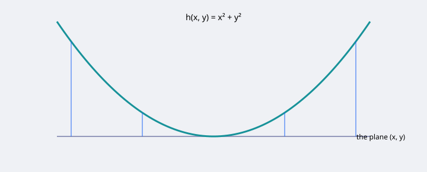
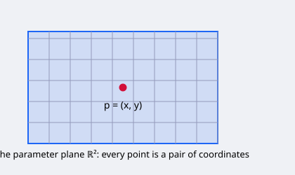
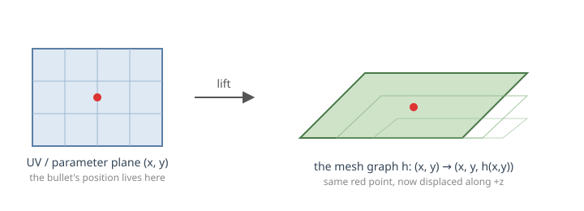
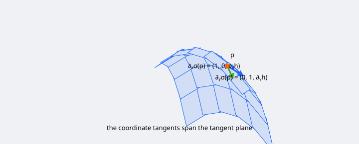
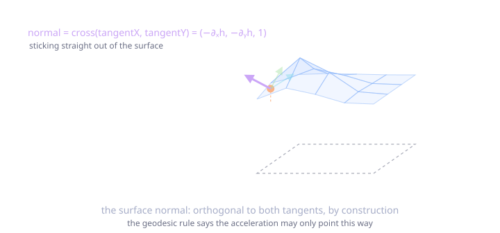
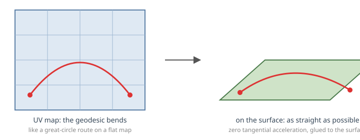

# Shooting Geodesics for Dummies

Suppose you have a surface given as the graph of a height function, and you
want to roll a marble across it with one unusual physics rule: the marble's
3D acceleration must always point along the surface normal — nothing else.
The paths that obey this rule are the **geodesics** of the surface, and the
"shooting method" in `lean/Brane/Shooting.lean` computes them numerically.
The only background you need is: partial derivatives, the dot product, and
how to multiply a matrix by a vector.

Everything below cites the actual Lean code. All definitions live in the
namespace `Brane.Shoot` (file `lean/Brane/Shooting.lean`) and the geometry
they are built from lives in `Brane.DiffGeom` (file
`lean/Brane/DifferentialGeometry.lean`).

The connection-theoretic side of the same story is in
[`connections.md`](connections.md); the Lie-algebra side is in
[`lie-algebra.md`](lie-algebra.md).

> The figures in this document are generated by the Lean program
> `lake exe gen-figures` (`make figures`), built with
> [Vizagrams](https://github.com/arademaker/vizagrams) on the Catppuccin
> Latte palette. Where a figure shows a trajectory or a vector field, it is
> *computed* from the very definitions this document explains — see
> `docs/figures.md`.

---

## 1. The surface: the graph of a height function

The surface is described by a single function `h` over a flat plane; every
other object of the theory is built from it. Here are the ingredients, each
defined explicitly, with the exact Lean names.

> [!NOTE]
> **Definition (`h`, the height function).** The **height function** is a
> value of type `HeightFun` — a function `ℝ → ℝ → ℝ` that assigns to each
> point `(x, y)` of the plane a real number: the height of the surface above
> it. There is no `def` for `h` itself — it is the abstract input of the
> whole theory, a free variable of type `HeightFun` that every other
> definition takes as its first argument:
>
> ```lean
> -- the type of the height function: two coordinates in, one height out
> --   h : HeightFun    i.e.    h x y = height above (x, y)
> -- there is no `def h`; it is the abstract parameter. Its type synonym is
> --   abbrev HeightFun : Type := ℝ → ℝ → ℝ
> -- and every definition takes it as its first argument:
> --   graph h,  tangentX h,  normal h,  hessian h,  geoAccel h ...
> -- concrete instances are supplied where needed:
> ```
>
> ```lean
> /-- A plane with slopes `a` and `b` and height `c` at the origin. -/
> def planeHeight {K : Type} [Mul K] [Add K] (a b c : K) (x y : K) : K :=
>   a * x + b * y + c
>
> /-- The paraboloid `z = x² + y²`. -/
> def bowlHeight {K : Type} [Mul K] [Add K] (x y : K) : K :=
>   x * x + y * y
>
> /-- The saddle `z = x² - y²`. -/
> def saddleHeight {K : Type} [Mul K] [Add K] [Sub K] (x y : K) : K :=
>   x * x - y * y
> ```
>
> (`DiffGeom.planeHeight`, `DiffGeom.bowlHeight`, `DiffGeom.saddleHeight`
> are the worked examples proved in `DifferentialGeometry.lean`.) They are
> polymorphic in the number type `K`: the theory instantiates them at `ℝ`,
> and the figure generator (`lake exe gen-figures`) at `Float` — see
> `docs/figures.md` for why.
>
> What Lean *does* define for every `h` are the derivatives, as one-variable
> derivatives:
>
> ```lean
> def partialX (h : HeightFun) (x y : ℝ) : ℝ := deriv (fun t => h t y) x
> def partialY (h : HeightFun) (x y : ℝ) : ℝ := deriv (fun t => h x t) y
>
> def partialXX (h : HeightFun) (x y : ℝ) : ℝ := deriv (fun t => partialX h t y) x
> def partialXY (h : HeightFun) (x y : ℝ) : ℝ := deriv (fun t => partialX h x t) y
> def partialYX (h : HeightFun) (x y : ℝ) : ℝ := deriv (fun t => partialY h t y) x
> def partialYY (h : HeightFun) (x y : ℝ) : ℝ := deriv (fun t => partialY h x t) y
> ```
>
> (`DiffGeom.partialX`, `DiffGeom.partialY`, `DiffGeom.partialXX`,
> `DiffGeom.partialXY`, `DiffGeom.partialYX`, `DiffGeom.partialYY`).
> In mathematical shorthand: `∂ₓh`, `∂ᵧh` for the first partials and
> `∂ₓₓh, ∂ₓᵧh, ∂ᵧₓh, ∂ᵧᵧh` for the second partials.



> [!NOTE]
> **Definition (`ℝ²`, the parameter plane).** The **parameter plane** is the
> domain of `h`: the plane `ℝ²`, whose points are pairs `p : ℝ × ℝ` with
> coordinates `p.1 = x` (`Prod.fst`) and `p.2 = y` (`Prod.snd`); its type
> synonym is `Point2 = ℝ × ℝ`. All
> simulation happens here: the marble's position is a `p : Point2`, its
> velocity is a vector in the plane
>
> ```lean
> abbrev Vel2 : Type := Fin 2 → ℝ   -- DiffGeom.Vel2
> ```
>
> and `h` is only *evaluated* on the plane to produce 3D points. (The
> `Vel2`-as-function convention is spelled out in §1.1.)



> [!NOTE]
> **Definition (`σ`, the surface map).** The **surface map** is the map
> `ℝ² → ℝ³`
>
> ```lean
> def graph (h : HeightFun) (p : Point2) : Point3 :=
>   vec3 p.1 p.2 (h p.1 p.2)
> ```
>
> and we write
>
> ```text
> σ := graph h,  i.e.  σ(p) = (p.1, p.2, h p.1 p.2),
> ```
>
> (`DiffGeom.graph`). It sends a plane point `p = (x, y)` to the surface
> point `(x, y, h(x, y))`: the first two coordinates are untouched, only the
> height is added. A path `γ : ℝ → ℝ²` in the plane then lifts to the 3D
> curve `σ ∘ γ` — the marble's actual position on the surface. The embedding
> map `σ` is the one whose derivatives (`∂ₓσ = tangentX h p`,
> `∂ᵧσ = tangentY h p`) appear in every formula below. Its defining
> equations are `rfl`-transparent:
>
> ```lean
> @[simp] theorem graph_fst (h) (p) : graph h p 0 = p.1 := rfl
> @[simp] theorem graph_snd (h) (p) : graph h p 1 = p.2 := rfl
> @[simp] theorem graph_height (h) (p) : graph h p 2 = h p.1 p.2 := rfl
> ```
>
> (`DiffGeom.graph_fst`, `DiffGeom.graph_snd`, `DiffGeom.graph_height`.)



> [!NOTE]
> **Definition (`tangentX`, `tangentY`).** The **coordinate tangents** are,
> at a point `p`, the two edge directions of the surface: the derivatives of
> `σ` in the `x`- and `y`-directions:
>
> ```lean
> def tangentX (h : HeightFun) (p : Point2) : Tangent :=
>   vec3 1 0 (partialX h p.1 p.2)   -- = ∂ₓσ(p) = (1, 0, ∂ₓh)
> def tangentY (h : HeightFun) (p : Point2) : Tangent :=
>   vec3 0 1 (partialY h p.1 p.2)   -- = ∂ᵧσ(p) = (0, 1, ∂ᵧh)
> ```
>
> (`DiffGeom.tangentX`, `DiffGeom.tangentY`). Together they span the
> tangent plane: every velocity the marble can have on the surface is a
> combination `v₀ · tangentX + v₁ · tangentY` of these two. Their
> coordinates are `rfl`/`simp`-transparent:
>
> ```lean
> @[simp] theorem tangentX_apply_zero (h) (p) : tangentX h p 0 = 1 := rfl
> @[simp] theorem tangentX_apply_one  (h) (p) : tangentX h p 1 = 0 := rfl
> @[simp] theorem tangentX_apply_two  (h) (p) :
>     tangentX h p 2 = partialX h p.1 p.2 := rfl
>
> @[simp] theorem tangentY_apply_zero (h) (p) : tangentY h p 0 = 0 := rfl
> @[simp] theorem tangentY_apply_one  (h) (p) : tangentY h p 1 = 1 := rfl
> @[simp] theorem tangentY_apply_two  (h) (p) :
>     tangentY h p 2 = partialY h p.1 p.2 := rfl
>
> @[simp] theorem norm_sq_tangentX (h) (p) :
>     ‖tangentX h p‖ ^ 2 = 1 + partialX h p.1 p.2 ^ 2 := by
>   rw [← real_inner_self_eq_norm_sq, inner_tangentX_tangentX]
>
> @[simp] theorem norm_sq_tangentY (h) (p) :
>     ‖tangentY h p‖ ^ 2 = 1 + partialY h p.1 p.2 ^ 2 := by
>   rw [← real_inner_self_eq_norm_sq, inner_tangentY_tangentY]
> ```
>
> (`DiffGeom.tangentX_apply_*`, `DiffGeom.tangentY_apply_*`,
> `DiffGeom.norm_sq_tangentX`, `DiffGeom.norm_sq_tangentY`.)



> [!NOTE]
> **Definition (`normal`).** The **surface normal** is the direction
> sticking out of the surface: the cross product of the two tangents,
>
> ```lean
> def normal (h : HeightFun) (p : Point2) : Normal :=
>   cross (tangentX h p) (tangentY h p)
> ```
>
> (`DiffGeom.normal`). Computed in coordinates it is
> `normal h p = (-∂ₓh, -∂ᵧh, 1)` (proved in `normal_eq`), and by
> construction it is orthogonal to both tangents — that orthogonality
> (`tangentX_inner_normal`, `tangentY_inner_normal`) is what turns the
> geodesic rule into a matrix equation in §2. The Lean facts about it:
>
> ```lean
> theorem normal_eq (h : HeightFun) (p : Point2) :
>     normal h p = vec3 (-partialX h p.1 p.2) (-partialY h p.1 p.2) 1 := by
>   rw [normal, tangentX, tangentY, cross_coordinates]
>   simp
>
> theorem normal_ne_zero (h : HeightFun) (p : Point2) : normal h p ≠ 0 := by
>   rw [normal_eq]
>   exact vec3_ne_zero_of_third _ _
>
> @[simp] theorem tangentX_inner_normal (h : HeightFun) (p : Point2) :
>     ⟪tangentX h p, normal h p⟫ = 0 := by
>   rw [normal]
>   exact inner_cross_left (tangentX h p) (tangentY h p)
>
> @[simp] theorem tangentY_inner_normal (h : HeightFun) (p : Point2) :
>     ⟪tangentY h p, normal h p⟫ = 0 := by
>   rw [normal, real_inner_comm]
>   exact inner_cross_right (tangentX h p) (tangentY h p)
>
> theorem norm_sq_normal (h : HeightFun) (p : Point2) :
>     ‖normal h p‖ ^ 2 =
>       1 + partialX h p.1 p.2 ^ 2 + partialY h p.1 p.2 ^ 2 := by
>   rw [← det_gramMatrix, det_gramMatrix_eq]
> ```
>
> (`DiffGeom.normal_eq`, `DiffGeom.normal_ne_zero`,
> `DiffGeom.tangentX_inner_normal`, `DiffGeom.tangentY_inner_normal`,
> `DiffGeom.norm_sq_normal`.)



> [!IMPORTANT]
> **Key point for everything that follows:** the whole simulation runs in
> the **parameter plane**. We never integrate in 3D; we integrate
> `(x(t), y(t))` and evaluate `h` to get the 3D point. Two coordinates of
> state, one function evaluation for the lift.

### 1.1 Notation

The following notational conventions are fixed here and used throughout the
remainder of this document without further remark.

> [!NOTE]
> **Vectors as functions.** In Lean, a 2-dimensional real vector is not a
> pair of floats but a *function* from the two-element index type `Fin 2`
> to `ℝ`:
>
> ```lean
> abbrev Vel2 : Type := Fin 2 → ℝ   -- DiffGeom.Vel2
> ```
>
> An element `v : Vel2` is written `v`; its components are the function
> values `v 0` and `v 1`. In ordinary mathematical notation we write
> `v = (v₀, v₁)` with `v₀ := v 0` and `v₁ := v 1`. In prose we use `v₀, v₁`;
> when quoting Lean verbatim we use `v 0, v 1`.

> [!NOTE]
> **Type synonyms.** To let signatures document the *role* of each argument,
> `DifferentialGeometry.lean` defines pure type synonyms. Each is
> definitionally equal to the type it abbreviates, so every lemma above
> applies unchanged — the alias only says what the value is *meant* to be:
>
> | Alias | Definition | Role |
> |---|---|---|
> | `Point2` | `abbrev Point2 : Type := ℝ × ℝ` | a point of the parameter plane |
> | `Point3` | `abbrev Point3 : Type := Vec3` | a position in ambient `ℝ³` |
> | `HeightFun` | `abbrev HeightFun : Type := ℝ → ℝ → ℝ` | a height function over the plane |
> | `Tangent` | `abbrev Tangent : Type := Vec3` | a tangent vector at a point |
> | `Normal` | `abbrev Normal : Type := Vec3` | a normal vector at a point |
> | `Accel2` | `abbrev Accel2 : Type := Vel2` | an acceleration in the plane |
> | `Accel3` | `abbrev Accel3 : Type := Vec3` | an acceleration in ambient `ℝ³` |
>
> E.g. `graph h p` is typed `(HeightFun) → (Point2) → (Point3)`, and
> `normal h p : Normal`, even though all of them compute at the type of
> plain coordinates.

> [!IMPORTANT]
> **Notation table.** The following notations appear in the Lean sources
> and are never re-explained at their use sites.
>
> | Notation | Lean name | Meaning |
> |---|---|---|
> | `r • x` | `SMul.smul` | scalar multiplication `r·x` of a real number `r` with a vector/matrix `x` |
> | `M *ᵥ v` | `Matrix.mulVec` | matrix–vector product `M·v` (`M` acts on the column vector `v`) |
> | `u ⬝ᵥ v` | `Matrix.dotProduct` | the dot product `Σᵢ uᵢ vᵢ` of two vectors |
> | `![a, b]` | `Matrix.vecCons` literal | the vector `(a, b)` as a function `Fin 2 → ℝ`; more generally `![a, b, c]` a 3-vector |
> | `!![a, b; c, d]` | `Matrix.of` literal | the 2×2 matrix with rows `(a, b)` and `(c, d)` |
> | `p.1`, `p.2` | `Prod.fst`, `Prod.snd` | the coordinates of `p : Point2`, i.e. `x` and `y` |
> | `⟪u, v⟫` | `inner` | the Euclidean inner product (same value as `u ⬝ᵥ v`) |

> [!TIP]
> **Reading example.** The combination that `jacobian_mulVec` proves the
> Jacobian produces,
>
> ```lean
> v 0 • tangentX h p + v 1 • tangentY h p
> ```
>
> reads, in strict mathematical notation, as
>
> ```text
> v₀ · ∂ₓσ(p) + v₁ · ∂ᵧσ(p),
> ```
>
> where `v₀ = v 0` and `v₁ = v 1` are the components of the velocity `v`,
> `•` is scalar multiplication, and the sum is the corresponding tangent
> vector: the velocity `v` of the marble on the surface, transported from
> plane coordinates to surface coordinates through the Jacobian.

---

## 2. The unusual physics rule

> [!IMPORTANT]
> **Definition (geodesic).** The acceleration of the 3D point must point
> exactly along the surface normal. Nothing else. No gravity, no friction —
> just "stay glued to the surface". A curve obeying this rule is called a
> **geodesic**.
>
> In Lean the rule is not a separate `def`; it is *encoded*: the
> orthogonality facts `tangentX_inner_normal` / `tangentY_inner_normal`
> (§1, `normal` box) say what "no tangential part" means, and the
> computable form of the rule is the acceleration `geoAccel h p v` below,
> together with the theorem `geoAccel_solves_geodesic` (proved below)
> stating that it satisfies the rule.

Intuition: the path a stretched rubber band takes when pinned at both ends
and pressed onto the surface; or the path you'd walk on the terrain feeling
no *turning* force, only the surface curving under your feet.

### Derivation of the geodesic equation

Let `γ(t) ∈ ℝ²` be a parameter curve, `v = dγ/dt`, `a = d²γ/dt²`, `σ = graph h`, `p = γ(t)`.

**Proposition.** For the lifted curve `σ ∘ γ`,
```text
(d²/dt²)(σ ∘ γ) = J a + (vᵀ H v) e₃,
```
and, when `σ ∘ γ` is a geodesic,
```text
0 = Jᵀ (d²/dt²)(σ ∘ γ) = G a + (vᵀ H v) ∇h,
```
hence `a = -G⁻¹ (vᵀ H v) ∇h = geoAccel(h, p, v)`.

*Proof.*

1. **Lift.** `(σ ∘ γ)(t) = (γ₁(t), γ₂(t), h(γ(t)))` (`DiffGeom.graph`).
2. **First derivative.** By the chain rule,
   ```text
   (d/dt)(σ ∘ γ) = (v₁, v₂, ∂ₓh · v₁ + ∂ᵧh · v₂) = J v,
   ```
   with `J = jacobian h p = [[1, 0], [0, 1], [∂ₓh, ∂ᵧh]]` (`DiffGeom.jacobian`, `DiffGeom.jacobian_mulVec`).
3. **Second derivative.** Differentiating componentwise (product and chain rule on `∂ᵢh ∘ γ`) yields
   ```text
   (d²/dt²)(σ ∘ γ) = (a₁, a₂, ∂ₓh · a₁ + ∂ᵧh · a₂ + vᵀ H v) = J a + (vᵀ H v) e₃,
   ```
   where `H = [[∂ₓₓh, ∂ₓᵧh], [∂ᵧₓh, ∂ᵧᵧh]]`, `e₃ = (0, 0, 1)`, and `vᵀ H v = v₀² ∂ₓₓh + v₀ v₁ (∂ₓᵧh + ∂ᵧₓh) + v₁² ∂ᵧᵧh` (`DiffGeom.hessian`, `Shoot.hessQuad`).
4. **Tangential projection.** A geodesic satisfies `(d²/dt²)(σ ∘ γ) ⟂ TₚΣ`, i.e. `⟪(d²/dt²)(σ ∘ γ), ∂ₓσ⟫ = ⟪(d²/dt²)(σ ∘ γ), ∂ᵧσ⟫ = 0`, equivalently `Jᵀ (d²/dt²)(σ ∘ γ) = 0`. With `Jᵀ J = G` (`DiffGeom.gramMatrix_eq_transpose_mul`) and `Jᵀ e₃ = ∇h` (since `⟪∂ₓσ, e₃⟫ = ∂ₓh`, `⟪∂ᵧσ, e₃⟫ = ∂ᵧh`),
   ```text
   0 = Jᵀ (J a + (vᵀ H v) e₃) = G a + (vᵀ H v) ∇h.
   ```
5. **Solution.** `det G = 1 + |∇h|² ≥ 1` (`DiffGeom.det_gramMatrix_eq`), so `G` is invertible and `a = -G⁻¹ (vᵀ H v) ∇h`. ∎

The corresponding Lean definitions and algebraic closure:

```lean
-- DifferentialGeometry.lean
def jacobian (h : HeightFun) (p : Point2) : Mat32 :=
  !![1, 0; 0, 1; partialX h p.1 p.2, partialY h p.1 p.2]

def hessian (h : HeightFun) (p : Point2) : Mat22 :=
  !![partialXX h p.1 p.2, partialXY h p.1 p.2;
     partialYX h p.1 p.2, partialYY h p.1 p.2]

def gramMatrix (h : HeightFun) (p : Point2) : Mat22 :=
  !![⟪tangentX h p, tangentX h p⟫, ⟪tangentX h p, tangentY h p⟫;
     ⟪tangentY h p, tangentX h p⟫, ⟪tangentY h p, tangentY h p⟫]

-- Shooting.lean
def gradientVec (h : K → K → K) (p : K × K) : Fin 2 → K :=
  ![partialX h p.1 p.2, partialY h p.1 p.2]

def hessQuad (h : K → K → K) (p : K × K) (v : Fin 2 → K) : K :=
  v 0 * (partialXX h p.1 p.2 * v 0 + partialXY h p.1 p.2 * v 1)
    + v 1 * (partialYX h p.1 p.2 * v 0 + partialYY h p.1 p.2 * v 1)

def geoAccel (h : K → K → K) (p : K × K) (v : Fin 2 → K) : Fin 2 → K :=
  let (g11, g12, g22) := gramEntries h p
  let det := g11 * g22 - g12 * g12
  let k := hessQuad h p v
  let (m₁, m₂) := (k * partialX h p.1 p.2, k * partialY h p.1 p.2)
  ![-(g22 * m₁ - g12 * m₂) / det, -(-(g12 * m₁) + g11 * m₂) / det]
```

`geoAccel` is the closed-form solution of `G a + (vᵀ H v) ∇h = 0`; the following Lean theorem states this algebraically.

```lean
theorem geoAccel_solves_geodesic (h : HeightFun) (p : Point2) (v : Vel2) :
    gramMatrix h p *ᵥ geoAccel h p v + hessQuad h p v • gradientVec h p = 0 := by
  -- det G = 1 + (∂ₓh)² + (∂ᵧh)² ≠ 0, so G·(-G⁻¹(k∇h)) + k∇h = 0 componentwise
  ext i; fin_cases i <;>
    simp [Matrix.mulVec, dotProduct, Fin.sum_univ_two, gramMatrix, geoAccel, gramEntries,
      gradientVec, inner_tangentX_tangentX, inner_tangentX_tangentY,
      inner_tangentY_tangentY, real_inner_comm (tangentY h p) (tangentX h p)] <;>
    field_simp [show (1 + partialX h p.1 p.2 ^ 2) * (1 + partialY h p.1 p.2 ^ 2) -
        (partialX h p.1 p.2 * partialY h p.1 p.2) ^ 2 ≠ 0 by
      have := det_gramMatrix_eq h p
      simp [gramMatrix, Matrix.det_fin_two, inner_tangentX_tangentX, inner_tangentX_tangentY,
        inner_tangentY_tangentY, real_inner_comm (tangentY h p) (tangentX h p)] at this ⊢
      linarith [sq_nonneg (partialX h p.1 p.2), sq_nonneg (partialY h p.1 p.2)]] <;>
    ring
```


### Are geodesics just straight lines in the plane? (the honest answer)

**Only if the surface is a perfect plane.** The curvature of the parameter
path comes entirely from `hessQuad = vᵀHv`:

> [!NOTE]
> **Degenerate case (the plane).** If `h(x, y) = a·x + b·y + c`, Lean
> already proves all second partials are zero (`partialXX_planeHeight`,
> `partialXY_planeHeight`, `partialYY_planeHeight`), so `H = 0`,
> `hessQuad = 0`, and `geoAccel = 0` for *every* velocity. The path is
> `pos += dt * vel` forever: straight lines in the plane, straight in 3D.

On any genuinely curved surface, `vᵀHv` is generally nonzero, so
`geoAccel ≠ 0` and the velocity genuinely turns as the marble rolls.

The mental model: **the parameter plane is a distorted map of the surface**,
like a flat map of the Earth. Great-circle flight routes are perfectly
"straight" on the globe but draw as curved arcs on the flat map, because the
map stretches distances differently at different latitudes. Same here: the
metric `G = JᵀJ` stretches the plane wherever the slope is steep
(`det G = 1 + |∇h|²` from `det_gramMatrix_eq` is exactly the stretch
factor), and the geodesic bends in the plane precisely **to stay as straight
as possible on the actual surface**. Flat slope along travel → little
distortion → nearly straight path in the plane. Strong curvature along
travel (`vᵀHv` large) → strong bending.

> [!TIP]
> **Concrete example, straight out of Lean.** The paraboloid
> `bowlHeight x y = x² + y²` has `partialXX = partialYY = 2` (proved in
> `DifferentialGeometry.lean`), so `H = 2I` and `vᵀHv = 2‖v‖²` — nonzero
> for every nonzero velocity. A shot across the bowl curves in the plane
> even on this perfectly symmetric surface.

> [!WARNING]
> **Terminology trap.** "Straight" always means *intrinsic* (zero
> tangential acceleration), never a straight line in ℝ³ — on a curved
> surface a geodesic cannot be a straight 3D line; it just wiggles
> vertically with `h` while being as straight as the surface allows. The
> whole point of `geoAccel` is that the velocity must be steered, one small
> time step at a time.



## 2.5 `e₃` and the surface normal

The surface normal is `n = ∂ₓσ × ∂ᵧσ = (-∂ₓh, -∂ᵧh, 1) = e₃ - ∇h` (`DiffGeom.normal_eq`):

```lean
def normal (h : HeightFun) (p : Point2) : Normal :=
  cross (tangentX h p) (tangentY h p)

theorem e3_eq_normal_add_gradient (h : HeightFun) (p : Point2) :
    normal h p + gradient h p = vec3 0 0 1 := by
  sorry
```

Thus `e₃ = n + ∇h`: `e₃` differs from `n` by a horizontal vector in `TₚΣ`, with equality iff `∇h = 0`. The decomposition `(d²/dt²)(σ ∘ γ) = J a + (vᵀ H v) e₃` uses the fixed ambient direction `e₃`; tangential projection annihilates the normal component and maps `e₃` to `∇h`, yielding `G a + (vᵀ H v) ∇h = 0`.

## 2.6 Connection reading: parallel velocity

The geodesic equation derived above has an equivalent connection-theoretic
reading, formalized in [`connections.md`](connections.md) and
`lean/Brane/Connections.lean` / `lean/Brane/ParallelTransport.lean`. It is
the same matrix equation, viewed as "keep the velocity parallel to itself".

### Covariant derivative in matrix/vector form

For a curve `γ(t)` in the parameter plane and a vector field `V(t) : Vel2`
along it, the covariant derivative is

```text
(DV/dt)^k = V̇^k + ∑_{i,j} Γ^k_{ij}(γ) γ̇^i V^j,
i.e.  DV/dt = V̇ + Γ(γ; γ̇, V).
```

In Lean this is `Trans.covAlongChristoffel`: the first term is ordinary
componentwise differentiation of a `Vel2`, and the second term is the
Christoffel correction `Conn.christoffelCorr`, the same kind of bilinear
vector contraction used throughout the shooting method.

### Parallel transport

`V` is **parallel** when `DV/dt = 0` (`Trans.isParallel`). Parallel
transport is the linear ODE

```text
V̇(t) = -Γ(γ(t); γ̇(t), V(t)),   V(t₀) = v₀,
```

whose solution is the transport map `Trans.transportMap Γ γ s t : Vel2 → Vel2`.
The map is linear and invertible along reversed curves
(`transportMap_linear`, `transportMap_reverse`, stated as `sorry` bridges in
the Lean file).

### Geodesic = velocity transported by itself

A geodesic is a curve whose velocity field is parallel along itself:

```lean
def isGeodesic (Γ : Point2 → Fin 2 → Mat22) (γ : Curve) : Prop :=
  isParallel Γ γ (curveVelocity γ)
```

Unfolding gives

```text
γ̈ + Γ(γ; γ̇, γ̇) = 0.
```

For the graph-surface Levi-Civita connection, whose symbols come from the
Gram matrix `G = gramMatrix h = JᵀJ`, this is the same equation as the
shooting-method Gram system. The Lean bridge theorem states the equivalence
exactly:

```lean
theorem isGeodesic_leviCivita_iff_Shoot (h : HeightFun) (γ : Curve) :
    isGeodesic (christoffel (gramMatrix h)) γ ↔
      ∀ t : ℝ, curveAccel γ t = Shoot.geoAccel h (γ t) (curveVelocity γ t)
```

Reading the shooting code through this lens:

| Shooting object | Connection reading |
| --- | --- |
| `gramMatrix h p` / `gramEntries` | metric `G = JᵀJ` whose Christoffel symbols define `leviCivita h` |
| `hessQuad h p v` | directional curvature `vᵀHv`, the scalar in the normal projection |
| `geoAccel h p v = -G⁻¹ (vᵀHv) ∇h` | Levi-Civita geodesic acceleration `-Γ(γ; γ̇, γ̇)` in matrix form |
| `field h s = ⟨v, geoAccel h p v⟩` | first-order form of the geodesic ODE |
| `shoot step h s₀ dt n` | numerical parallel-velocity integration (Euler/RK4) |

So `shoot` is not just "integrate an acceleration"; it is a discrete
transport of the velocity by the Levi-Civita connection of the surface.

---

## 3. Shooting = "fire and integrate"

Like the shooting method of numerical analysis: pick an initial position and
direction, then integrate the ODE with a fixed time step and watch where the
trajectory ends up. Everything in this section is a plain definition in
`Shooting.lean` — no proofs yet, by design.

> [!NOTE]
> **The number type is abstract.** Every definition in this section is
> polymorphic in the number type `K`, quantified over the `GeoKernel K`
> class: the six partial derivatives of a height function (`partialX`,
> `partialY`, `partialXX`, `partialXY`, `partialYX`, `partialYY`) plus the
> numerals (`zero`, `one`, `two`, `six`) the formulas need. Over `ℝ` the
> kernel is Mathlib's `deriv` — i.e. exactly the `DiffGeom.partial*` of §1;
> over `Float` it is central finite differences, and that computable
> instance is what the figure generator executes. The numerals appear in
> `rk4Step` as `two` / `six` (class fields, since a generic `K` cannot
> auto-generalize numeric literals).

### The state

The state of a second-order ODE is a position plus a velocity: the
acceleration only tells the velocity how to change, so to step the system
forward you must carry both. Here everything lives in the parameter plane:

```lean
/-- The state of a shot: parameter position and parameter velocity. -/
structure ShotState (K : Type) where
  pos : K × K
  vel : Fin 2 → K   -- components are `vel 0` and `vel 1`, i.e. (v₀, v₁)
```

It has coordinatewise `Add`, `SMul K` and `Zero` instances
(`addShotState`, `smulShotState`, `zeroShotState`) — the vector-space
structure that symmetric one-step integrators need to be expressible.

### The vector field

The derivative of the state along the flow pairs the two components: the
position's derivative is the velocity, and the velocity's derivative is the
geodesic acceleration `geoAccel`:

```lean
def field (h : K → K → K) (s : ShotState K) : ShotState K :=
  ⟨(s.vel 0, s.vel 1), geoAccel h s.pos s.vel⟩
```

It does not depend on time, so every integrator just reads `field h s`.

### The integrator interface

```lean
/-- A one-step method: given the surface `h`, the current state and the
time step, produce the next state. -/
abbrev StepMethod (K : Type) := (K → K → K) → ShotState K → K → ShotState K
```

This is the function type shared by every integrator in the file: Euler and
RK4 are both instances of it, and the trajectory code never knows which one
it got.

### Explicit Euler (the cheap one)

The simplest integrator there is — sample the slope once, march straight,
repeat:

```lean
def eulerStep : StepMethod K := fun h s dt => s + dt • field h s
```

Its drawback: it undershoots on curves (each step cuts the corner of
the true path) and the error accumulates every step. On a strongly curved
surface the trajectory visibly spirals off the geodesic.


### Runge–Kutta 4 (the accurate one)

Same `StepMethod` interface, four `field` evaluations per step: slope at the
start (`k₁`), two midpoint probes (`k₂, k₃`), slope at the end (`k₄`),
then a 1–2–2–1 weighted average:

```lean
/-- One classical Runge–Kutta 4 step:
`sₙ₊₁ = sₙ + Δt/6 · (k₁ + 2k₂ + 2k₃ + k₄)`, where `k₁` is the slope at the
start, `k₂, k₃` the two midpoint probes and `k₄` the slope at the end. -/
def rk4Step : StepMethod K := fun h s dt =>
  let k₁ := field h s
  let k₂ := field h (s + (dt / two) • k₁)
  let k₃ := field h (s + (dt / two) • k₂)
  let k₄ := field h (s + dt • k₃)
  s + (dt / six) • (k₁ + two • k₂ + two • k₃ + k₄)
```

Euler is first-order accurate (error per step ∝ `dt²`), RK4 is fourth-order
(error per step ∝ `dt⁵`): four times the work per step, vastly better
accuracy, and it is the classical workhorse of numerical ODE solving.


### The trajectory

The trajectory is just iteration of the chosen stepper — a recursion on `n`:

```lean
def shoot (step : StepMethod K) (h : K → K → K) (s₀ : ShotState K) (dt : K) :
    ℕ → ShotState K
  | 0 => s₀
  | (n + 1) => step h (shoot step h s₀ dt n) dt
```

i.e. `shoot step h s₀ dt 0 = s₀` (the initial state) and each step applies
`step h · dt` to the previous state. Two named convenience wrappers:

```lean
abbrev eulerTrajectory (h) (s₀) (dt) (n) : ShotState K := shoot eulerStep h s₀ dt n
abbrev rk4Trajectory   (h) (s₀) (dt) (n) : ShotState K := shoot rk4Step   h s₀ dt n
```

Because both go through the same `shoot`, any future theorem about
trajectories is stated once against `shoot` and instantiated for both
steppers. That is the whole reason `StepMethod` exists.

### Initial state and spatial point

```lean
/-- The initial state: start at `p` with velocity `speed` in the direction
`dir`. -/
def muzzle (p : Point2) (dir : Vel2) (speed : ℝ) : ShotState :=
  ⟨p, fun k => speed * dir k⟩

/-- The spatial point reached by a shot: the lifted parameter position. -/
def impactPoint (h : HeightFun) (s : ShotState) : Point3 :=
  graph h s.pos
```

`muzzle` sets up the start of the trajectory; `impactPoint` is the 3D point
`(x, y, h(x, y))` the marble occupies.

---

## 4. Why "shooting"?

Because it's the shooting method from boundary-value problems: you don't
know the whole path, you **aim, fire, and watch where the shot lands**.
If the landing point is wrong, adjust the aim and fire again. The loop
is, with the exact Lean calls:

1. `muzzle p dir speed` — set up the initial `(pos, vel)` in the parameter
   plane.
2. `shoot eulerStep h s₀ dt n` or `shoot rk4Step h s₀ dt n` — integrate
   `n` steps of size `dt`.
3. `impactPoint h (shoot ... n)` — where it hit.
4. Not happy? Retune `p`, `dir`, `speed` (and, for accuracy, `dt` / `n`)
   and go to 1.

> [!WARNING]
> Note what is *not* in the loop: any target condition. `shoot` integrates
> a fixed number of steps; stopping at a boundary, hitting a goal point,
> or bisection on the aim direction are all future work on top of it.

---

## 5. Proven vs. declared

Everything in `Shooting.lean` is currently a *definition* — the equations
are declared, nothing is proved about them. Here is the honest ledger:

| Fact | Status | Where |
|---|---|---|
| `normal h p = (-∂ₓh, -∂ᵧh, 1)`, never zero | **proved** | `normal_eq`, `normal_ne_zero` |
| `gramMatrix h p = Jᵀ J`, `det G = 1 + |∇h|² ≥ 1` | **proved** | `gramMatrix_eq_transpose_mul`, `det_gramMatrix_eq` |
| `jacobian_mulVec`: plane velocity → tangent combination | **proved** | `jacobian_mulVec` |
| Jacobians of tangents carry the Hessian rows | **proved** | `jacobianTangentX_apply`, `jacobianTangentY_apply` |
| Plane/bowl/saddle partials up to second order | **proved** | `partial*_planeHeight`, `partial*_bowlHeight`, `partial*_saddleHeight` |
| `geoAccel` solves the geodesic condition `G (d²γ/dt²) + (vᵀHv)∇h = 0` | proved algebraically (Lean proof in §2) | `Shooting.lean` (`geoAccel_solves_geodesic`, still `sorry` there) |
| Christoffel geodesic ↔ `geoAccel` shooting ODE | declared (`sorry`) | `ParallelTransport.lean` (`isGeodesic_leviCivita_iff_Shoot`) |
| Euler converges to the geodesic as `dt → 0` | declared | future |
| RK4 is fourth-order accurate | declared | future |
| discrete trajectory hugs the true geodesic | declared | future |

In other words: the geometry layer (`DifferentialGeometry.lean`) is fully
proved, while the physics layer (`Shooting.lean`) runs on paper and is
waiting for its proofs.

---

## 6. Cheat sheet: file ↔ concept

| `Brane/Shooting.lean` | Plain-language description | Connection reading |
|---|---|---|
| `ShotState` | position and velocity of the marble, both in the parameter plane | state `(γ, γ̇)` of the geodesic ODE |
| `field h s` | the `(v, a)` right-hand side of the ODE: velocity plus geodesic acceleration | first-order Levi-Civita geodesic field |
| `geoAccel h p v` | the steering acceleration `-(G⁻¹ ((vᵀ H v) ∇h))` (Lean writes `*ᵥ` for the matrix product and `•` for scalar multiplication — see the notation table in §1) | matrix form of `-Γ(γ; γ̇, γ̇)` |
| `StepMethod` | the shared type of one-step integrators: surface, state, time step → next state | one-step numerical transport scheme |
| `eulerStep` / `rk4Step` | the two integrators; identical interface | first/fourth-order discrete transport |
| `shoot step h s₀ dt n` | `n`-fold iteration of the stepper, starting from `s₀` | numerical integration of parallel velocity |
| `muzzle p dir speed` | the initial state of a trajectory | initial point and velocity for transport |
| `impactPoint h s` | the 3D surface point `(x, y, h(x,y))` at a state | lifted point `σ(γ(t))` |
| `gradientVec`, `hessQuad` | the parameter gradient and the directional curvature of `h` | metric/Hessian data entering `Γ` on a graph |
| `DiffGeom.gramMatrix`, `DiffGeom.hessian` | the metric matrix `G` and the Hessian `H`, evaluated at a point | metric and second-fundamental-form ingredients |

---

## References

### Primary encyclopedia articles

* Wikipedia, [Geodesic](https://en.wikipedia.org/wiki/Geodesic)
* Wikipedia, [Christoffel symbols](https://en.wikipedia.org/wiki/Christoffel_symbols)
* Wikipedia, [Riemannian manifold](https://en.wikipedia.org/wiki/Riemannian_manifold)
* Wikipedia, [Shooting method](https://en.wikipedia.org/wiki/Shooting_method)
* Wikipedia, [Euler method](https://en.wikipedia.org/wiki/Euler_method)
* Wikipedia, [Runge–Kutta methods](https://en.wikipedia.org/wiki/Runge%E2%80%93Kutta_methods)
* Wikipedia, [Numerical methods for ordinary differential equations](https://en.wikipedia.org/wiki/Numerical_methods_for_ordinary_differential_equations)

### Wolfram MathWorld

* [Geodesic](https://mathworld.wolfram.com/Geodesic.html)
* [Christoffel Symbol of the Second Kind](https://mathworld.wolfram.com/ChristoffelSymboloftheSecondKind.html)
* [Shooting Method](https://mathworld.wolfram.com/ShootingMethod.html)
* [Euler Method](https://mathworld.wolfram.com/EulerForwardMethod.html)
* [Runge-Kutta Method](https://mathworld.wolfram.com/Runge-KuttaMethod.html)

### nLab

* [geodesic](https://ncatlab.org/nlab/show/geodesic)
* [Riemannian manifold](https://ncatlab.org/nlab/show/Riemannian+manifold)

### Encyclopedia of Mathematics

* [Geodesic line](https://encyclopediaofmath.org/wiki/Geodesic_line)
* [Shooting method](https://encyclopediaofmath.org/wiki/Shooting_method)

### Free books and lecture notes

* V. V. Datar, *Lectures on Riemannian Geometry* —
  <https://math.iisc.ac.in/~vvdatar/Lecture_Notes/RG_Lectures_typesett_published.pdf>
* M. Taylor, *Riemannian Geometry* (Imperial College notes) —
  <https://www.ma.imperial.ac.uk/~mtaylor5/rgnotes.pdf>
* W. Merry, *Differential Geometry* (ETH, 2021) —
  <https://www2.math.ethz.ch/will-merry/files/Merry%20-%20Differential%20Geometry%20%282021%29.pdf>
* D. Wilkins, *A Course in Riemannian Geometry* —
  <https://www.maths.tcd.ie/~dwilkins/Courses/425/RiemGeom.pdf>
* C. Wendl, *Lecture Notes on Bundles and Connections* —
  <https://www.mathematik.hu-berlin.de/~wendl/connections.html>
* M. Taylor, *Connections and Curvature* (Appendix C) —
  <https://mtaylor.web.unc.edu/wp-content/uploads/sites/16915/2018/04/appendc.pdf>
* L. Nicolaescu, *Lectures on the Geometry of Manifolds* —
  <https://academicweb.nd.edu/~lnicolae/Lectures.pdf>

### Papers and books

* M. P. do Carmo, *Differential Geometry of Curves and Surfaces*,
  Prentice Hall, 1976.
* J. Milnor, *Morse Theory*, Annals of Mathematics Studies 51, Princeton
  University Press, 1963.
* E. Hairer, S. P. Nørsett, and G. Wanner, *Solving Ordinary Differential
  Equations I: Nonstiff Problems*, 2nd ed., Springer, 1993.
* J. C. Butcher, "Coefficients for the study of Runge–Kutta integration
  processes", *J. Austral. Math. Soc.* **3** (1963), 185–201.
  DOI: [10.1017/S1446788700027932](https://doi.org/10.1017/S1446788700027932)

See [`../bibtex.md`](../bibtex.md) for the human-readable link list and
[`../references.bib`](../references.bib) for the BibTeX entries.
